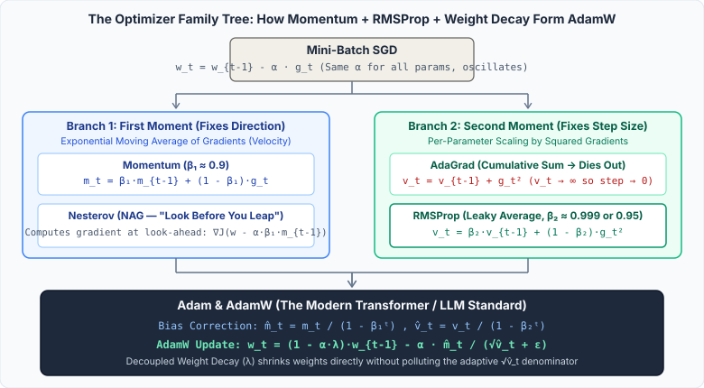
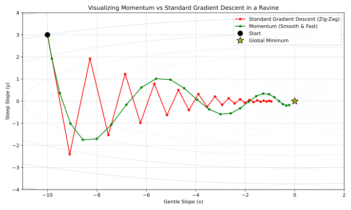
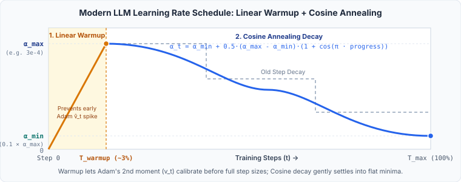

# 3. Optimization Algorithms and Convolutional Neural Networks

As neural networks grow to billions of parameters and datasets scale to trillions of tokens, vanilla Gradient Descent becomes unusable. Furthermore, standard fully-connected layers (ANNs) explode in parameter count when fed high-resolution spatial data like images.

In this chapter, we trace the **complete evolution of Deep Learning Optimizers** — from Mini-Batch SGD and Momentum all the way to **AdamW and Cosine Warmup Schedules** (the engine behind every modern LLM) — followed by **Convolutional Neural Networks (CNNs)** and how they connect directly to Vision Transformers (ViTs).

---

## Part 1: The Evolution of Optimization Algorithms



---

### §1 — Batch vs. Stochastic vs. Mini-Batch Gradient Descent

Suppose your training dataset has $M = 5,000,000$ examples. How many examples should you pass through the network before updating the weights $W$?

| Variant | Batch Size ($B$) | Updates per Epoch | Pros | Cons |
| :--- | :--- | :--- | :--- | :--- |
| **Batch Gradient Descent** | $B = M$ (Full dataset) | **1 update** | Exact, noise-free gradient direction | Computationally impossible at scale; gets trapped in sharp local minima & saddle points |
| **Stochastic GD (SGD)** | $B = 1$ (Single example) | $5,000,000$ updates | Updates immediately; high noise helps escape bad local minima | Extremely noisy trajectory; **wastes GPU parallelism** (cannot vectorize matrix math on 1 item) |
| **Mini-Batch GD (Standard)** | $B \in [32, 4096]$ | $M / B$ updates | **Sweet spot:** saturates GPU Tensor Cores via matrix multiplication while updating thousands of times per epoch | Oscillates across steep ravines unless paired with Momentum / Adaptive scaling |

```
  Trajectory on Loss Contour Map:

  Batch GD (B = M):       Start ●──────────────────────────► ★ Minimum (Smooth, but 1 step takes hours)
  Pure SGD (B = 1):       Start ●─/\─\/─/\─\─/\─\/─/\──────► ★ Minimum (Fast steps, erratic noise)
  Mini-Batch (B = 256):   Start ●──~\──~\──~\──────────────► ★ Minimum (Vectorized on GPU + fast convergence)
```

---

### §2 — The Mathematical Building Block: Exponentially Weighted Moving Averages (EWMA)

Every modern optimizer (Momentum, RMSProp, Adam, AdamW) relies on one core mathematical tool to remember the past without storing thousands of historical gradient tensors in GPU RAM: the **Exponentially Weighted Moving Average (EWMA)**.

Given a noisy stream of measurements $g_1, g_2, \dots, g_t$ (such as mini-batch gradients), we maintain a running average $v_t$ using a decay hyperparameter $\beta \in [0, 1)$:

$$v_t = \beta \, v_{t-1} + (1 - \beta)\, g_t \qquad (\text{initialized at } v_0 = 0)$$

#### What Does $\beta$ Physically Mean? (Effective Memory Window)
If you unroll the recursion $v_t = (1-\beta)\big(g_t + \beta g_{t-1} + \beta^2 g_{t-2} + \dots\big)$, the weights decay exponentially into the past. A useful rule of thumb is that an EWMA averages roughly over the last **$\frac{1}{1 - \beta}$ steps**:

| Decay $\beta$ | Effective Window $\approx \frac{1}{1 - \beta}$ | Physical Behavior |
| :--- | :--- | :--- |
| **$\beta = 0.0$** | $1$ step | No memory at all ($v_t = g_t$, pure mini-batch gradient) |
| **$\beta = 0.9$** | **$\sim 10$ steps** | Standard for **1st Moment (Momentum)** $\beta_1$ in Adam |
| **$\beta = 0.99$** | **$\sim 100$ steps** | Smooths over 100 mini-batches |
| **$\beta = 0.999$** | **$\sim 1,000$ steps** | Standard for **2nd Moment (RMSProp)** $\beta_2$ in Adam (`0.95` in LLMs) |

#### Why Do We Need Bias Correction ($\frac{v_t}{1 - \beta^t}$)?
Because we initialize $v_0 = 0$, the first few steps are **severely biased toward zero**!
Suppose the true gradient is $g_t = 10$ on every step, and $\beta = 0.9$:
- **Step $t = 1$:** $v_1 = 0.9(0) + 0.1(10) = \mathbf{1.0}$ (10× smaller than the true value `10`!)
- **Step $t = 2$:** $v_2 = 0.9(1.0) + 0.1(10) = \mathbf{1.9}$ (Still way below `10`!)

Dividing by **$(1 - \beta^t)$** completely eliminates this cold-start bias:
$$\hat{v}_1 = \frac{v_1}{1 - 0.9^1} = \frac{1.0}{0.1} = \mathbf{10.0} \quad \checkmark \qquad\qquad \hat{v}_2 = \frac{v_2}{1 - 0.9^2} = \frac{1.9}{0.19} = \mathbf{10.0} \quad \checkmark$$

And as $t \to \infty$, $\beta^t \to 0$, so $(1 - \beta^t) \to 1$ and bias correction naturally turns itself off!

---

### §3 — Momentum & Nesterov Accelerated Gradient (Fixing the Direction)

#### The Ravine Problem (Ill-Conditioned Curvature)
Deep neural network loss landscapes are rarely round bowls; they are long, narrow **ravines** (canyons) where the slope is **very steep vertically ($y$)** across the walls of the canyon, but **very gentle horizontally ($x$)** along the floor toward the minimum:



- If you set the learning rate $\alpha$ small enough not to explode up the steep vertical walls, progress along the gentle horizontal floor is agonizingly slow.
- If you increase $\alpha$, standard Gradient Descent violently bounces back and forth between the north and south canyon walls ($+g_y, -g_y, +g_y, -g_y$).

#### 1. Classical Momentum (Polyak Heavy-Ball Method)
**Momentum** treats the weight vector like a heavy iron ball rolling down a hill with velocity $m_t$:

$$m_t = \beta_1 m_{t-1} + (1 - \beta_1) g_t \qquad (\text{typically } \beta_1 = 0.9)$$

$$w_t = w_{t-1} - \alpha \, m_t$$

*(Note: PyTorch's `torch.optim.SGD(momentum=0.9)` uses the equivalent unscaled form $m_t = \beta_1 m_{t-1} + g_t$, which simply scales the effective step size by $\frac{1}{1-\beta_1} = 10\times$.)*

**Why Momentum Solves the Ravine:**
- **Vertical axis ($y$):** The gradients alternate sign on every bounce ($+8, -8, +8, -8$). When averaged into $m_t$, positive and negative vertical gradients **cancel each other out toward zero**!
- **Horizontal axis ($x$):** All gradients point consistently in the same direction ($+0.5, +0.5, +0.5$). They **add up constructively**, building terminal velocity straight down the canyon floor!

#### 2. Nesterov Accelerated Gradient (NAG — "Look Before You Leap")
One flaw of standard Momentum is that when the heavy ball reaches the bottom of the valley, it has built up so much velocity $\beta_1 m_{t-1}$ that it rolls right past the minimum and up the opposite slope before slowing down.

**Nesterov Momentum** fixes this with a simple change in where the gradient is evaluated:
1. **Standard Momentum:** Computes gradient at the *current* position $w_{t-1}$, then adds the momentum jump.
2. **Nesterov (NAG):** First applies the momentum jump to peek at the **look-ahead position** $\tilde{w} = w_{t-1} - \alpha \beta_1 m_{t-1}$, and computes the gradient **at that future point**:

$$m_t = \beta_1 m_{t-1} + \nabla_w J\big(\underbrace{w_{t-1} - \alpha \beta_1 m_{t-1}}_{\text{Look-ahead position } \tilde{w}}\big), \qquad w_t = w_{t-1} - \alpha \, m_t$$

```
  Standard Momentum:                          Nesterov Momentum (NAG):
  1. Compute grad at current w_{t-1}          1. First jump by momentum to look-ahead w̃
  2. Combine with velocity                    2. Compute grad AT w̃ (sees the uphill slope early!)
                                                       w̃ (look-ahead)
     w_{t-1} ●───────► w_t                       w_{t-1} ● - - - ► ○
              \     ↗                                     \       ↙ (brakes early!)
               ▼   /                                       ▼     ▼
             grad at w_{t-1}                              w_t (corrected)
```

Because NAG evaluates the slope *where the ball is about to land*, it sees the upcoming uphill wall in advance and applies the brakes before overshooting.

---

### §4 — Adaptive Step Sizes: AdaGrad $\to$ RMSProp (Fixing Per-Parameter Scale)

In a Transformer, different layers and parameters have wildly different gradient magnitudes:
- Rare token embeddings might only receive a gradient once every 1,000 batches.
- Frequent tokens or final projection weights receive huge gradients on every batch.
Using a **single global scalar learning rate $\alpha$** for all parameters is suboptimal. We want a **custom step size for every individual parameter $w_i$**.

#### 1. AdaGrad (Adaptive Gradient, 2011)
AdaGrad tracks the **cumulative sum of squared gradients** for each parameter since step 0:

$$v_t = v_{t-1} + g_t^2, \qquad w_t = w_{t-1} - \frac{\alpha}{\sqrt{v_t} + \varepsilon} \, g_t$$

- **The Good:** Rare features with tiny $v_t$ get a large effective learning rate; frequent features with huge $v_t$ get a smaller learning rate.
- **The Fatal Flaw in Deep Learning:** Because $g_t^2 \ge 0$ is always positive, the cumulative sum $v_t$ **grows monotonically to $\infty$** over thousands of steps! Eventually $\frac{\alpha}{\sqrt{v_t}} \to 0$, and the network completely stops learning before reaching the minimum.

#### 2. RMSProp (Root Mean Square Propagation — Hinton, 2012)
**RMSProp** rescues AdaGrad with a one-line fix: replace the infinite cumulative sum with a **leaky Exponentially Weighted Moving Average of squared gradients**:

$$v_t = \beta_2 v_{t-1} + (1 - \beta_2) g_t^2 \qquad (\text{where } g_t^2 \text{ is element-wise squared gradient})$$

$$w_t = w_{t-1} - \frac{\alpha}{\sqrt{v_t} + \varepsilon} \, g_t$$

**How RMSProp Automatically Equalizes Steep vs. Flat Directions:**
- **Steep wall parameter ($g_y = \pm 10$):** $g_y^2 = 100 \implies \sqrt{v_y} \approx 10$. The update divides by $10$, **shrinking the step $10\times$** so it stops bouncing off the walls!
- **Flat valley parameter ($g_x = 0.01$):** $g_x^2 = 0.0001 \implies \sqrt{v_x} \approx 0.01$. The update divides by $0.01$, **amplifying the step $100\times$** so it races across flat plateaus and saddle points!

---

### §5 — Adam and AdamW: The King of LLM Optimizers

#### 1. Adam (Adaptive Moment Estimation — Kingma & Ba, 2014)
**Adam** combines **Momentum (1st Moment — mean of gradients)** and **RMSProp (2nd Moment — uncentered variance of gradients)** together with **Bias Correction**:

$$\begin{aligned}
\text{1. First Moment (Momentum):} \quad & m_t = \beta_1 m_{t-1} + (1 - \beta_1) g_t \\
\text{2. Second Moment (RMSProp):} \quad & v_t = \beta_2 v_{t-1} + (1 - \beta_2) g_t^2 \\
\text{3. Bias Correction:} \quad & \hat{m}_t = \frac{m_t}{1 - \beta_1^t}, \qquad \hat{v}_t = \frac{v_t}{1 - \beta_2^t} \\
\text{4. Parameter Update:} \quad & w_t = w_{t-1} - \alpha \, \frac{\hat{m}_t}{\sqrt{\hat{v}_t} + \varepsilon}
\end{aligned}$$

*Standard hyperparameters:*
- **General Deep Learning:** $\beta_1 = 0.9$, $\beta_2 = 0.999$, $\varepsilon = 10^{-8}$.
- **Large Language Models (GPT-3, LLaMA, Qwen):** $\beta_1 = 0.9$, **$\beta_2 = 0.95$**, $\varepsilon = 10^{-8}$ (a smaller $\beta_2 = 0.95$ forgets ancient gradient spikes in ~20 steps instead of 1,000 steps, improving stability during LLM pre-training!).

#### Concrete Numerical Walkthrough: Why Adam Normalizes Step Sizes
Suppose at step $t = 1$ ($\beta_1 = 0.9, \beta_2 = 0.999, \alpha = 0.001, \varepsilon = 10^{-8}$), we have two weights:
- **$w_{\text{steep}}$** receives a huge gradient $g = 20.0$.
- **$w_{\text{flat}}$** receives a tiny gradient $g = 0.02$.

| Calculation Step | Steep Weight ($g = 20.0$) | Flat Weight ($g = 0.02$) | What Happened? |
| :--- | :--- | :--- | :--- |
| **Raw SGD Step ($-\alpha g$)** | $-0.001 \times 20 = \mathbf{-0.020}$ | $-0.001 \times 0.02 = \mathbf{-0.00002}$ | SGD steps $1,000\times$ harder on steep weight! |
| **1st Moment $m_1 = 0.1 g$** | $2.0$ | $0.002$ | Captures sign & magnitude |
| **Bias-Corrected $\hat{m}_1 = m_1 / 0.1$** | $20.0$ | $0.02$ | Exact unbiased mean |
| **2nd Moment $v_1 = 0.001 g^2$** | $0.400$ | $0.0000004$ | Captures squared magnitude |
| **Bias-Corrected $\hat{v}_1 = v_1 / 0.001$** | $400.0 \implies \sqrt{\hat{v}_1} = \mathbf{20.0}$ | $0.0004 \implies \sqrt{\hat{v}_1} = \mathbf{0.02}$ | Root-mean-square scale |
| **Final Adam Step ($-\alpha \frac{\hat{m}_1}{\sqrt{\hat{v}_1}}$)** | $-0.001 \times \frac{20.0}{20.0} = \mathbf{-0.001}$ | $-0.001 \times \frac{0.02}{0.02} = \mathbf{-0.001}$ | **Both take an exact, safe step of $-\alpha = -0.001$!** |

Notice that $\frac{\hat{m}_t}{\sqrt{\hat{v}_t}}$ acts like a **Signal-to-Noise Ratio (SNR)**: when the gradient direction is consistent, the step size is bounded around $\pm \alpha$ regardless of whether the raw gradient is $20.0$ or $0.02$!

---

#### 2. AdamW (Decoupled Weight Decay — Loshchilov & Hutter, 2019)
Why does every LLM training script use `torch.optim.AdamW` instead of `torch.optim.Adam`?

In **SGD**, adding L2 regularization $\frac{\lambda}{2}\|w\|^2$ to the loss function is mathematically identical to decaying the weights by $(1 - \alpha \lambda)w$.
**In Adam, L2 regularization and Weight Decay are NOT equivalent!**
- If you add L2 penalty $\frac{\lambda}{2}\|w\|^2$ to the loss in standard Adam, its derivative $\lambda w$ gets added into the gradient: $g_t^{\text{reg}} = g_t + \lambda w_{t-1}$.
- That means the weight decay term $\lambda w_{t-1}$ gets **divided by $\sqrt{\hat{v}_t}$**! Weights with large historical gradients ($\sqrt{\hat{v}_t} \gg 1$) receive almost zero regularization, while weights with tiny gradients get over-penalized.

**AdamW** fixes this by **decoupling** weight decay from the gradient calculation, applying shrinkage directly to the weights just before the Adam step:

$$w_t = \underbrace{(1 - \alpha \lambda) \, w_{t-1}}_{\text{Decoupled Weight Decay}} - \underbrace{\alpha \, \frac{\hat{m}_t}{\sqrt{\hat{v}_t} + \varepsilon}}_{\text{Clean Adam Gradient Update}}$$

> [!IMPORTANT]
> **Why AdamW Uses So Much GPU Memory in LLMs (The 16-Byte Rule):**
> Because AdamW stores **two extra FP32 state tensors** ($m_t$ and $v_t$) for every trainable parameter:
> - FP32 Master Weight ($w$): `4 bytes`
> - FP32 Gradient ($g$): `4 bytes`
> - FP32 1st Moment ($m_t$): `4 bytes`
> - FP32 2nd Moment ($v_t$): `4 bytes`
> That equals **16 bytes per parameter** (just for weights + gradients + optimizer states, before activations!). For a 7-Billion parameter LLM, $7\text{B} \times 16\text{ bytes} \approx \mathbf{112\text{ GB of VRAM}}$ — which is the exact reason **LoRA** (only storing $m_t, v_t$ for $<1\%$ adapter weights) and **ZeRO / FSDP** (sharding $m_t, v_t$ across GPUs) are essential!

---

### §6 — Learning Rate Schedules: Linear Warmup + Cosine Annealing

Even with AdamW, keeping a constant learning rate $\alpha$ throughout training leads to two failures:
1. **Early Explosion (Step 1 to 1,000):** At initialization, Transformer weights are random, self-attention distributions have high entropy, and Adam's second moment $v_t$ has only seen a handful of mini-batches (high variance). Taking a full $\alpha_{\max}$ step right at step 1 causes attention logits to spike and training loss to diverge (`NaN`).
2. **Late Oscillation:** Near the end of training, a large $\alpha$ bounces around the rim of the minimum instead of settling into the flattest valley floor.

The universal solution in modern Transformers (GPT, LLaMA, ViT, BERT) is **Linear Warmup followed by Cosine Annealing**:



1. **Phase 1 — Linear Warmup ($0 \le t \le T_{\text{warmup}}$, typically first 1%–5% of steps):**
   $$\alpha_t = \alpha_{\max} \cdot \frac{t}{T_{\text{warmup}}}$$
   Gradually ramps $\alpha_t$ from $0$ up to $\alpha_{\max}$ (e.g., $3 \times 10^{-4}$), giving Adam's running variance $\hat{v}_t$ time to calibrate accurately before taking full-sized steps.
2. **Phase 2 — Cosine Annealing Decay ($T_{\text{warmup}} < t \le T_{\max}$):**
   $$\alpha_t = \alpha_{\min} + \frac{1}{2}(\alpha_{\max} - \alpha_{\min})\left(1 + \cos\!\left(\frac{t - T_{\text{warmup}}}{T_{\max} - T_{\text{warmup}}} \, \pi\right)\right)$$
   Smoothly decays $\alpha_t$ along a half-cosine curve down to $\alpha_{\min} \approx 0.1 \, \alpha_{\max}$.

---

### §7 — Master Comparison of Optimizers

| Optimizer | 1st Moment ($m_t$)? | 2nd Moment ($v_t$)? | States Stored per Param | Key Behavior & Best Use Case |
| :--- | :--- | :--- | :--- | :--- |
| **Mini-Batch SGD** | No | No | `0` | Fast, zero memory overhead, but very slow on ill-conditioned ravines |
| **SGD + Momentum / NAG** | Yes ($\beta_1$) | No | `1` ($m_t$) | Classic standard for CNNs (ResNets) where generalization on vision is strong |
| **AdaGrad** | No | Cumulative $\sum g^2$ | `1` ($G_t$) | Good for sparse tabular/NLP features; **dies out** on deep networks |
| **RMSProp** | No | Leaky EMA ($\beta_2$) | `1` ($v_t$) | Equalizes steep vs. flat gradients; used in RNNs and early RL (DQN) |
| **Adam** | Yes ($\beta_1$) | Yes ($\beta_2$) | `2` ($m_t, v_t$) | Fast convergence out-of-the-box, but L2 regularization is coupled with $v_t$ |
| **AdamW** | Yes ($\beta_1$) | Yes ($\beta_2$) | `2` ($m_t, v_t$) | **The LLM & Transformer Standard.** Decouples weight decay from adaptive step |

---

## Part 2: Convolutional Neural Networks (CNNs)

Why couldn't we just use the fully-connected ANNs from Chapter 1 to process high-resolution images?

Consider a standard $1000 \times 1000$ RGB color image ($1000 \times 1000 \times 3 = 3,000,000$ input numbers). If the first hidden layer of a dense ANN had just $1,000$ neurons, the weight matrix $W_1$ connecting them would require **$3,000,000 \times 1,000 = 3\text{ Billion parameters}$ in a single layer!** That destroys GPU memory and immediately memorizes noise (overfits) because it ignores the 2D spatial structure of pixels.

**Convolutional Neural Networks (CNNs)** solve this via two physical inductive biases:
1. **Local Connectivity (Sparsity of Connections):** A pixel in the top-left corner has almost zero direct edge correlation with a pixel in the bottom-right corner. Each neuron only looks at a small local patch (e.g., $3 \times 3$ pixels — its **Local Receptive Field**).
2. **Parameter Sharing (Translation Equivariance):** A $3 \times 3$ vertical-edge detector learned in the top-left corner works equally well in the center or bottom-right corner. The **exact same 9 weights** are slid across the entire image!

---

### §1 — The 2D Convolution Operation (Sliding Filter)



Instead of a giant matrix multiplication, we slide (convolve) a small learnable **Filter / Kernel** $K \in \mathbb{R}^{f \times f}$ across the input image $I$. At every spatial position $(i, j)$, we compute the **Frobenius inner product** (element-wise multiply and sum):

$$\text{FeatureMap}(i, j) = \sum_{u=0}^{f-1} \sum_{v=0}^{f-1} I(i + u, \; j + v) \cdot K(u, v) + b$$

For example, a classic **Vertical Edge Detector** kernel is:
```
  Filter K (3×3):
  [ +1   0  -1 ]
  [ +1   0  -1 ]   ──► Multiplies left column by +1, middle by 0, right column by -1.
  [ +1   0  -1 ]       Lights up with a large positive number wherever bright pixels meet dark pixels!
```

In a CNN, **we never hand-craft these numbers** — backpropagation learns the filter weights automatically:
- **Early layers (Layers 1–2):** Learn simple Gabor-like edge, corner, and color-gradient detectors.
- **Middle layers (Layers 3–10):** Combine edges into textures, honeycombs, eyes, wheels, and foliage.
- **Deep layers:** Combine parts into whole semantic objects (faces, cars, dogs).

---

### §2 — Padding ($P$), Stride ($S$), and the Output Dimension Formula

When sliding an $f \times f$ filter across an $H_{\text{in}} \times W_{\text{in}}$ image, two hyperparameters control the output spatial size:
- **Padding ($P$):** Adding a border of $P$ zeros around the image edges so edge pixels are visited just as often as center pixels and the spatial dimensions don't shrink on every layer.
  - **Valid Convolution ($P = 0$):** No padding; output shrinks by $f - 1$.
  - **Same Convolution ($P = \frac{f - 1}{2}$ for stride $1$):** Output height and width stay **identical** to the input ($H_{\text{out}} = H_{\text{in}}$).
- **Stride ($S$):** How many pixels the filter steps horizontally/vertically each move. Setting $S = 2$ skips every other pixel, downsampling height and width by $2\times$ ($4\times$ fewer total pixels).

#### Exact Output Spatial Dimension Formula (Interview Must-Know)

$$H_{\text{out}} = \left\lfloor \frac{H_{\text{in}} + 2P - f}{S} \right\rfloor + 1, \qquad W_{\text{out}} = \left\lfloor \frac{W_{\text{in}} + 2P - f}{S} \right\rfloor + 1$$

| Input Size ($H_{\text{in}}$) | Filter ($f$) | Padding ($P$) | Stride ($S$) | Calculation $\lfloor \frac{H_{\text{in}} + 2P - f}{S} \rfloor + 1$ | Output Size ($H_{\text{out}}$) | Mode Name |
| :--- | :--- | :--- | :--- | :--- | :--- | :--- |
| $32 \times 32$ | $3 \times 3$ | $P = 0$ | $S = 1$ | $\lfloor \frac{32 + 0 - 3}{1} \rfloor + 1$ | **$30 \times 30$** | Valid Conv (Shrinks) |
| $32 \times 32$ | $3 \times 3$ | $P = 1$ | $S = 1$ | $\lfloor \frac{32 + 2 - 3}{1} \rfloor + 1$ | **$32 \times 32$** | **Same Conv** (Preserves size) |
| $32 \times 32$ | $3 \times 3$ | $P = 1$ | $S = 2$ | $\lfloor \frac{32 + 2 - 3}{2} \rfloor + 1$ | **$16 \times 16$** | Strided Downsampling ($\div 2$) |
| $224 \times 224$ | $16 \times 16$ | $P = 0$ | $S = 16$ | $\lfloor \frac{224 + 0 - 16}{16} \rfloor + 1$ | **$14 \times 14$** | **ViT Patchify!** ($196$ patches) |

> [!TIP]
> **Look at the last row of the table above ($224 \times 224$ with $f = 16, S = 16$):**
> When a **Vision Transformer (ViT)** splits a $224 \times 224 \times 3$ image into $14 \times 14 = 196$ non-overlapping $16 \times 16$ patches and projects each patch to $d_{\text{model}} = 768$, how is that implemented in PyTorch?
> Literally as a **single Convolutional Layer** with kernel size $16$ and stride $16$:
> `nn.Conv2d(in_channels=3, out_channels=768, kernel_size=16, stride=16)`!

---

### §3 — Multi-Channel 3D Convolutions & Parameter Counting

Real images have $C_{\text{in}} = 3$ channels (Red, Green, Blue), and hidden feature maps have $C_{\text{in}} = 64, 128, \text{ or } 512$ channels.
- **Rule 1:** A single filter must span **all input channels $C_{\text{in}}$ simultaneously**, so one $3 \times 3$ filter is actually a 3D volume of shape **$C_{\text{in}} \times f \times f$**, producing **1 output channel**.
- **Rule 2:** To produce $C_{\text{out}}$ output feature maps, we learn a bank of $C_{\text{out}}$ distinct 3D filters:

$$\text{Conv2d Weight Tensor Shape:} \quad [C_{\text{out}}, \; C_{\text{in}}, \; f, \; f]$$

$$\text{Total Trainable Parameters:} \quad C_{\text{out}} \times \big(C_{\text{in}} \times f \times f + 1_{\text{bias}}\big)$$

---

### §4 — Pooling Layers & Landmark CNN Architectures

1. **Max Pooling & Average Pooling:**
   - A $2 \times 2$ Max Pooling layer with stride $2$ slides a $2 \times 2$ window over each channel independently and keeps only the single largest activation ($\max$) in each $2 \times 2$ block.
   - **Zero learnable parameters:** Halves height and width ($H \times W \to \frac{H}{2} \times \frac{W}{2}$) and provides local translation invariance.
2. **ResNets (Residual Networks — He et al., 2015):**
   - Stacking 50+ convolutional layers caused gradients to vanish and training error to *degrade*.
   - **Residual Skip Connections** add the unmodified input $x$ directly to the block's output:
     $$y = \mathcal{F}(x, \{W_i\}) + x$$
   - Because $\frac{\partial y}{\partial x} = \frac{\partial \mathcal{F}}{\partial x} + \mathbf{1}$, the $+1$ acts as an uninterrupted **gradient superhighway** all the way back to the first layer — a design directly inherited by every **Transformer Block** (`x = x + Attention(LayerNorm(x))`)!
3. **Inception Networks (GoogLeNet):**
   - Computes $1 \times 1$, $3 \times 3$, and $5 \times 5$ convolutions + MaxPool **in parallel** at the same layer and concatenates their channel outputs, using **$1 \times 1$ pointwise convolutions** as channel bottlenecks to shrink compute cost by $10\times$.
