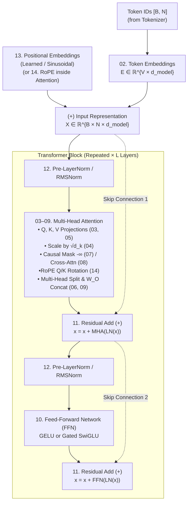

# Transformer Core Mechanics

> Sources: *Build a Large Language Model (From Scratch)* (Sebastian Raschka, Ch. 2–4) | RASA Algorithm Whiteboard | Stanford CME295

This folder dissects every single building block inside a Transformer block from bottom to top. Every modern LLM (GPT, LLaMA, Qwen, Claude) and Encoder (BERT, ViT) is assembled from these exact components.

---

## How the 13 Core Mechanics Fit Into One Transformer Block

---

## Folder Reading Order

1. **[02_Token_Embeddings__The_Input_to_Everything.md](file:///Users/vusheshbabuadhikari/Learning/git/Building_LLM_from_scratch/transformers_basics/02_Transformer_Core_Mechanics/02_Token_Embeddings__The_Input_to_Everything.md)** — Embedding lookup table $E \in \mathbb{R}^{V \times d_{\text{model}}}$, equivalence to one-hot matrix multiplication, and weight tying.
2. **[03_Attention_Mechanism.md](file:///Users/vusheshbabuadhikari/Learning/git/Building_LLM_from_scratch/transformers_basics/02_Transformer_Core_Mechanics/03_Attention_Mechanism.md)** — Query ($Q$), Key ($K$), Value ($V$) intuition and single-token query routing.
3. **[04_Why_Scale_by_dk.md](file:///Users/vusheshbabuadhikari/Learning/git/Building_LLM_from_scratch/transformers_basics/02_Transformer_Core_Mechanics/04_Why_Scale_by_dk.md)** — Why variance grows linearly with $d_k$ ($\text{Var}(q\cdot k) = d_k$) and how dividing by $\sqrt{d_k}$ prevents Softmax saturation and vanishing gradients.
4. **[05_SelfAttention.md](file:///Users/vusheshbabuadhikari/Learning/git/Building_LLM_from_scratch/transformers_basics/02_Transformer_Core_Mechanics/05_SelfAttention.md)** — Matrix formulation $\text{softmax}(QK^\top / \sqrt{d_k})V$, step-by-step $3 \times 2$ numerical walkthrough, and permutation invariance.
5. **[06_MultiHead_Attention.md](file:///Users/vusheshbabuadhikari/Learning/git/Building_LLM_from_scratch/transformers_basics/02_Transformer_Core_Mechanics/06_MultiHead_Attention.md)** — Running $h$ parallel attention heads so different heads specialize in distinct syntactic/semantic relationships.
6. **[07_Causal_Masking.md](file:///Users/vusheshbabuadhikari/Learning/git/Building_LLM_from_scratch/transformers_basics/02_Transformer_Core_Mechanics/07_Causal_Masking.md)** — Look-ahead masking with $-\infty$ before Softmax (`torch.triu` + `masked_fill`) and attention dropout.
7. **[08_Cross_Attention.md](file:///Users/vusheshbabuadhikari/Learning/git/Building_LLM_from_scratch/transformers_basics/02_Transformer_Core_Mechanics/08_Cross_Attention.md)** — Routing Decoder Queries ($Q_{\text{dec}}$) against Encoder Keys and Values ($K_{\text{enc}}, V_{\text{enc}}$).
8. **[09_MHA_Split_Geometry__Concat__Dense.md](file:///Users/vusheshbabuadhikari/Learning/git/Building_LLM_from_scratch/transformers_basics/02_Transformer_Core_Mechanics/09_MHA_Split_Geometry__Concat__Dense.md)** — Subspace projection geometry, $W_O$ mixing, parameter counting, and PyTorch's fused 4D tensor reshape (`[B, N, d_model] → [B, h, N, d_k]`).
9. **[10_FeedForward_Networks__Activation_Functions.md](file:///Users/vusheshbabuadhikari/Learning/git/Building_LLM_from_scratch/transformers_basics/02_Transformer_Core_Mechanics/10_FeedForward_Networks__Activation_Functions.md)** — Position-wise FFN expansion, ReLU vs. GELU vs. gated SwiGLU.
10. **[11_Residual_Skip_Connections.md](file:///Users/vusheshbabuadhikari/Learning/git/Building_LLM_from_scratch/transformers_basics/02_Transformer_Core_Mechanics/11_Residual_Skip_Connections.md)** — Residual highways ($x + \text{SubLayer}(x)$) and why deep Transformers don't suffer from vanishing gradients.
11. **[12_Layer_Normalisation.md](file:///Users/vusheshbabuadhikari/Learning/git/Building_LLM_from_scratch/transformers_basics/02_Transformer_Core_Mechanics/12_Layer_Normalisation.md)** — LayerNorm vs. BatchNorm, worked numerical examples for LayerNorm and RMSNorm, and Pre-Norm vs. Post-Norm.
12. **[13_Positional_Embeddings.md](file:///Users/vusheshbabuadhikari/Learning/git/Building_LLM_from_scratch/transformers_basics/02_Transformer_Core_Mechanics/13_Positional_Embeddings.md)** — Learned Absolute Positional Embeddings (GPT-2/BERT), Sinusoidal PE ($\sin/\cos$ conjugate proof), and ALiBi score biases.
13. **[14_RoPE__Rotary_Positional_Embeddings.md](file:///Users/vusheshbabuadhikari/Learning/git/Building_LLM_from_scratch/transformers_basics/02_Transformer_Core_Mechanics/14_RoPE__Rotary_Positional_Embeddings.md)** — 2D coordinate rotation of $Q$ and $K$ inside attention and exact relative-distance invariance.
