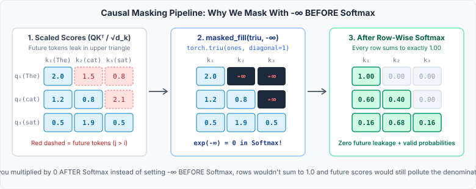

## 6. Causal Masking (Look-Ahead Masking)

In Phase 1, we learned that during self-attention, **every token queries every other token simultaneously**. The formula $S = QK^\top$ computes the similarity scores between all tokens.

However, if we are training a **Decoder-Only LLM** (like GPT or LLaMA) to predict the *next* word, we have a massive problem. 



### The Problem: Cheating
Imagine we feed the sequence `"The cat sat"` into the model and ask it to predict the word after `"The"`. 

During training, the model processes the entire sequence at once for efficiency. If the token `"The"` is allowed to do self-attention over the whole sequence, it can look forward and see that the next word is `"cat"`. It will instantly learn to just copy the next word, completely failing to learn any actual language modeling.

### The Solution: The Mask
To prevent this, we apply a **Causal Mask** (or Look-Ahead Mask) to the raw attention scores before applying the softmax. 

The rule is simple: **A token at position $i$ can only attend to tokens at positions $j \le i$.** It can look at itself and the past, but it cannot look at the future.

### The Math
We achieve this by taking the $N \times N$ matrix of raw scores ($QK^\top$) and forcibly setting the entire upper triangle (above the diagonal) to **negative infinity ($-\infty$)**.

**Before Masking:**
$$S_{raw} = \begin{bmatrix} s_{11} & s_{12} & s_{13} \\ s_{21} & s_{22} & s_{23} \\ s_{31} & s_{32} & s_{33} \end{bmatrix}$$

**After Masking:**
$$S_{masked} = \begin{bmatrix} s_{11} & -\infty & -\infty \\ s_{21} & s_{22} & -\infty \\ s_{31} & s_{32} & s_{33} \end{bmatrix}$$

**Why negative infinity?** Because the very next step is the `softmax` function, which exponentiates the scores: $e^{x}$. 
$$e^{-\infty} = 0$$

So, when softmax is applied, the weights for all future tokens become exactly $0$. 

**After Softmax:**
$$A = \begin{bmatrix} 1.0 & 0 & 0 \\ 0.6 & 0.4 & 0 \\ 0.2 & 0.7 & 0.1 \end{bmatrix}$$

Now, when we compute the final output $A \cdot V$:
- Token 1's output is made *only* from Token 1's value.
- Token 2's output is a mix of Token 1 and 2's values.
- Token 3's output is a mix of Token 1, 2, and 3's values.

### Why Not Just Multiply by `0` *After* Softmax? (Common Interview Question)
If you computed Softmax over the full unmasked row first (e.g., row 1 weights `[0.50, 0.30, 0.20]`) and *then* zeroed out the upper triangle (`[0.50, 0.00, 0.00]`):
1. **Broken Probability Distribution:** Row 1 now sums to `0.50` instead of `1.00`!
2. **Future Information Leakage:** Even if you re-normalized, the raw score of future tokens ($e^{s_{12}} + e^{s_{13}}$) was already inside the Softmax denominator $\sum_{j=1}^3 e^{s_{1j}}$, meaning future tokens still altered the magnitude of past weights!
By setting $s_{ij} = -\infty$ **before** Softmax, $e^{-\infty} = 0$ contributes **zero** to both the numerator and denominator.

### PyTorch Implementation + Attention Dropout (Raschka Ch. 3)
```python
# 1. Create upper-triangular boolean mask above the main diagonal (diagonal=1):
mask = torch.triu(torch.ones(context_length, context_length), diagonal=1)

# 2. Fill upper-triangle where mask == 1 with -inf BEFORE softmax:
attn_scores.masked_fill_(mask.bool()[:num_tokens, :num_tokens], -torch.inf)

# 3. Apply row-wise softmax and optional Attention Dropout (e.g. p=0.1 during training):
attn_weights = torch.softmax(attn_scores / (d_k ** 0.5), dim=-1)
attn_weights = dropout(attn_weights)
```

### Summary
By simply adding $-\infty$ to the upper triangle of the score matrix, we force the model to be strictly autoregressive (causal). It learns to predict the future based only on the past, even though it processes the entire sequence in parallel!
