## 8. MHA Split Geometry — Concat + Dense

Each head operates on a $d_k$-dimensional **projection** of the full input, not a slice.

```
  Input X  [N × 512]
       │
       ├─────────────────────────────────────────────────┐
       │  W_Q¹,W_K¹,W_V¹  [512→64]   W_Qʰ,W_Kʰ,W_Vʰ  [512→64]
  ┌──────────┐                                    ┌──────────┐
  │  Head 1  │  softmax(Q₁K₁ᵀ/√64)·V₁           │  Head 8  │
  │  [N×64]  │                                    │  [N×64]  │
  └────┬─────┘                                    └────┬─────┘
       │                                               │
       └───────────────── CONCAT ────────────────────┘
                              │
                       [N × 512]   (64 × 8 = 512)
                              │
                       × W_O  [512 × 512]   ← Dense
                              │
                       Output [N × 512]
```

**Why W_O matters:** Without it, head 1's 64-dim output and head 2's 64-dim output would sit in permanently isolated subspaces — they'd never interact. $W_O$ is the only step where information flows across heads.



### Parameter count (d_model=512, h=8, d_k=64)

| Weight | Shape | Parameters |
|---|---|---|
| $W_Q^{(i)}, W_K^{(i)}, W_V^{(i)}$ per head | 512 × 64 each | 32,768 × 3 = 98,304 |
| All 8 heads | — | 8 × 98,304 = **786,432** |
| $W_O$ output projection | 512 × 512 | **262,144** |
| **Total MHA** | | **~1.05 M** |

This is the same parameter count as a single-head attention with full 512-dim Q, K, V. Multi-head doesn't add parameters — it redistributes them across specialised subspaces.

---

### How PyTorch Actually Computes All Heads in Parallel (Fused Projection + 4D Tensor Reshape)

In code (*Build a Large Language Model from Scratch*, Ch. 3), we do **not** run a Python `for` loop over 8 separate `nn.Linear(512, 64)` layers. Instead, we use **one single fused matrix** `W_q = nn.Linear(512, 512)` and split the last dimension via `.view()` and `.transpose(1, 2)`:

```python
# Input x shape: [batch_size B, seq_len N, d_model=512] (with num_heads h=8, head_dim d_k=64)

# 1. Single fused projection for all heads at once:
Q = self.W_q(x)                                    # [B, N, 512]

# 2. Split 512 into (h=8, d_k=64) and swap N and h so heads become a batch-like dimension:
Q = Q.view(B, N, h, d_k).transpose(1, 2)           # [B, N, 8, 64] ──► [B, 8, N, 64]
K = self.W_k(x).view(B, N, h, d_k).transpose(1, 2) # [B, 8, N, 64]
V = self.W_v(x).view(B, N, h, d_k).transpose(1, 2) # [B, 8, N, 64]

# 3. Single batched matrix multiply computes Q·Kᵀ for all 8 heads simultaneously!
attn_scores = Q @ K.transpose(-2, -1)              # [B, 8, N, 64] @ [B, 8, 64, N] ──► [B, 8, N, N]
attn_weights = torch.softmax(attn_scores / (d_k ** 0.5), dim=-1)

# 4. Multiply by V, swap h and N back, and flatten (CONCAT) into [B, N, 512]:
context = (attn_weights @ V).transpose(1, 2).contiguous().view(B, N, 512)
output = self.W_o(context)                         # [B, N, 512]
```

> **Note on Modern GQA / MQA (See Folder `06`):** In standard MHA, $Q$, $K$, and $V$ all have $h$ heads (e.g., 32 Q heads, 32 K heads, 32 V heads). In modern LLMs (LLaMA-3, Mistral, Qwen), **Grouped-Query Attention (GQA)** keeps 32 Query heads but shares fewer Key/Value heads (e.g., only 8 K/V heads, where each group of 4 Q heads shares 1 K and 1 V head) to shrink the inference **KV Cache** by $4\times$!

---
