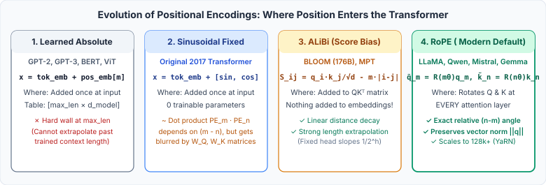

## 12. Positional Embeddings (Learned Absolute, Sinusoidal, and ALiBi)

### Why needed?

Self-attention is **permutation-invariant** (shown in §4). Feed it tokens in any order and it returns the same outputs, just reordered. It has no built-in sense of which token came first. Positional embeddings inject order information.



$$v_i^* = v_i + p_i$$

The positional vector $p_i$ is added to each token embedding before the first block. After that addition, the model can distinguish tokens by position.

### 1. Learned Absolute Positional Embeddings — GPT-2, GPT-3, BERT, ViT (Raschka Ch. 2 & 4)

The simplest approach (used in GPT-2 and BERT) is to create a **second trainable `nn.Embedding(context_length, d_model)` lookup table** dedicated purely to positions `0, 1, ..., context_length - 1`:

```python
# GPT-2 setup (context_length = 1024, d_model = 768):
tok_emb_layer = nn.Embedding(vocab_size, d_model)       # Shape: [50257, 768]
pos_emb_layer = nn.Embedding(context_length, d_model)   # Shape: [1024,  768]

# Forward pass for an input batch of shape [batch_size, seq_len]:
tok_embeds = tok_emb_layer(token_ids)                   # [B, seq_len, 768]
pos_embeds = pos_emb_layer(torch.arange(seq_len))       # [seq_len, 768]
x = tok_embeds + pos_embeds                             # Broadcasts across batch B!
```

- **How it learns:** Row $m$ of `pos_emb_layer` starts as random noise and is updated via backpropagation so the model learns what "being at position $m$" means.
- **The Fatal Limitation:** If `context_length = 1024`, the table only has rows `0 .. 1023`. You **cannot** feed a 1,025-token prompt at inference time because row `1024` does not exist (`IndexError`), and even if you enlarged the table, positions $>1023$ were never trained!

---

### 2. Sinusoidal — Original Transformer (2017)

$$PE_{m,2i} = \sin\!\left(\frac{m}{10000^{\,2i/d_{model}}}\right) \qquad PE_{m,2i+1} = \cos\!\left(\frac{m}{10000^{\,2i/d_{model}}}\right)$$

- $m$ → position of token in sequence
- $i$ → dimension index within the embedding (out of $d_{model}/2$ pairs)

Each position $m$ gets a unique vector of alternating sin/cos values at different frequencies $\omega_i = 10000^{-2i/d_{model}}$.

### Why sin AND cos — not just sin

The dot product between two positional encodings $\langle PE_m, PE_n \rangle$ should depend only on **relative distance** $(m-n)$, not on absolute positions. Sin alone fails this:

**Sin only:**
$$\langle PE_m, PE_n \rangle = \sum_i \sin(\omega_i m)\sin(\omega_i n) = \tfrac{1}{2}\sum_i\left[\cos(\omega_i(m-n)) - \cos(\omega_i(m+n))\right]$$

- First term $\cos(\omega_i(m-n))$: depends only on relative distance ✓
- Second term $\cos(\omega_i(m+n))$: depends on **absolute positions** ✗

**Sin + cos pair:**
$$\sin(\omega_i m)\sin(\omega_i n) + \cos(\omega_i m)\cos(\omega_i n) = \cos(\omega_i(m-n))$$

The absolute-position term cancels perfectly. The full dot product becomes:

$$\langle PE_m, PE_n \rangle = \sum_i \cos(\omega_i(m-n)) = f(m-n) \quad \checkmark$$

Sin and cos are the **conjugate pair** required for the cancellation — not an arbitrary choice.

### ALiBi — Attention with Linear Biases

Instead of adding positional encoding to embeddings, ALiBi adds a **bias directly to the attention scores** before softmax:

$$\text{softmax}\!\left(\frac{QK^\top}{\sqrt{d_k}} + \mathbf{B}\right)$$

where $B_{ij} = -m \cdot |i - j|$ — a linear penalty that grows with token distance.

The slopes $m$ are **not learned** — they are hardcoded as a geometric sequence across heads:

$$m_1 = \tfrac{1}{2^1},\quad m_2 = \tfrac{1}{2^2},\quad \ldots,\quad m_h = \tfrac{1}{2^h}$$

This was a deliberate design choice: no extra parameters, no extra training cost. The fixed decay pattern is what gives ALiBi its extrapolation capability — because slopes are hardcoded rather than learned, they generalise to sequence lengths far beyond what was seen during training.

### No absolute positional embeddings

ALiBi adds **nothing** to the token embeddings. The input vector is purely:

```
  token vector = embedding_table[token_id]   ← no + p_i anywhere
```

Instead, for every $(m, n)$ pair in the $N \times N$ attention score matrix, a bias is subtracted before softmax:

$$\text{score}_{mn} = \frac{q_m \cdot k_n}{\sqrt{d_k}} - s \cdot |m - n|$$

Visualising the full score matrix (head slope $s = \tfrac{1}{2}$):

```
  Raw QKᵀ/√dk:          ALiBi bias:              Biased scores:

  [ s₁₁  s₁₂  s₁₃ ]   [ -0   -½   -1  ]   [ s₁₁      s₁₂-½   s₁₃-1  ]
  [ s₂₁  s₂₂  s₂₃ ] + [ -½   -0   -½  ] = [ s₂₁-½    s₂₂     s₂₃-½  ]
  [ s₃₁  s₃₂  s₃₃ ]   [ -1   -½   -0  ]   [ s₃₁-1    s₃₂-½   s₃₃    ]

  diagonal (same position) → bias 0
  off-diagonal grows with distance → bias increasingly negative
```

Tokens far away are structurally penalised before softmax runs. Each head decays at a different rate — head 1 ($s=\tfrac{1}{2}$) drops off fast, head $h$ ($s=\tfrac{1}{2^h}$) is almost flat, letting different heads specialise in local vs long-range context.

### Extrapolation — why no absolute encoding helps

Because position information is never baked into the embeddings, the model can handle sequences **longer than it was trained on** at inference — the bias pattern just extends naturally to new $(m, n)$ distances. Learned absolute embeddings break at unseen positions; ALiBi does not.

### Which models use ALiBi

| Model | Notes |
|---|---|
| **BLOOM** (176B, BigScience) | One of the first large-scale LLMs to use ALiBi |
| **MPT-7B / MPT-30B** (MosaicML) | ALiBi for long-context efficiency |
| **BloomZ** | Instruction-tuned variant of BLOOM |

ALiBi never became the dominant choice for modern LLMs — RoPE won out, partly because RoPE integrates better with long-context extensions (YaRN, LongRoPE). LLaMA, Mistral, Gemma, and most post-2023 models all use RoPE.

---
