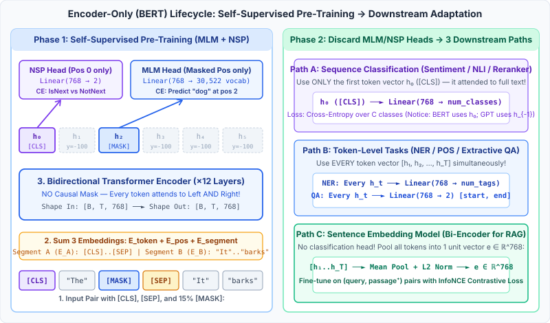
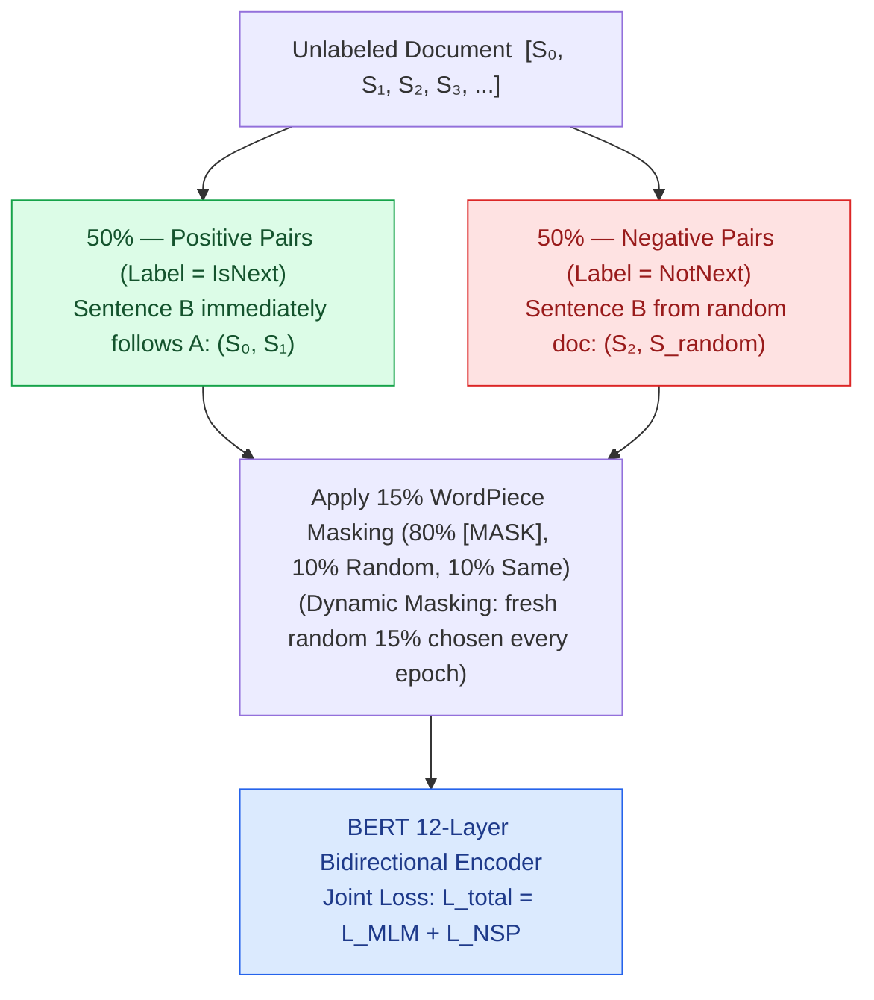

# 5. BERT & Encoder-Only Models: Complete Guide (From Pre-Training to Classification, NER & Embeddings)

> How Encoder-Only Transformers (`BERT`, `RoBERTa`, `DeBERTa`, `ModernBERT`) work from top to bottom: why they discard the Decoder, why they need special tokens (`[CLS]`, `[SEP]`, `[MASK]`), how their self-supervised pre-training (`MLM` + `NSP`) routes tokens, and how we build **Classification, NER, QA, and Embedding models** on top of them.



---

## §1 — The Big Picture: What Is an Encoder-Only Model Trying to Do?

When you look at the three families of Transformers, each is designed for a fundamentally different job:

| Model Family | Attention Type | Primary Superpower | Cannot Easily Do | Canonical Examples |
| :--- | :--- | :--- | :--- | :--- |
| **Encoder-Decoder** | Bidirectional Encoder + Causal Decoder + Cross-Attention | Sequence-to-sequence transformation (input text $\to$ output text) | More complex than needed for pure generation or pure classification | Original 2017 Transformer, `T5`, `BART` |
| **Decoder-Only** | **Causal (Left-to-Right only)** | **Autoregressive Generation** (predicting token $t+1$ from tokens $\le t$) | Token $t$ is blind to tokens $>t$ on its right | `GPT-2/3/4`, `LLaMA`, `Claude`, `Qwen` |
| **Encoder-Only** | **100% Bidirectional (Left AND Right)** | **Deep Language Understanding & Representation** (Classification, NER, Extractive QA, Embeddings) | Cannot generate free-form text autoregressively | `BERT`, `RoBERTa`, `DeBERTa`, `ModernBERT` |

### Why Discard the Decoder? (The "Bank" Problem)
Suppose you want a model to read a sentence and classify its sentiment, tag named entities (like people and locations), or create a semantic embedding vector. You are **not** generating new words one by one — the entire input text is **already available upfront**!

Consider what happens when a **Causal Decoder (GPT)** reads the word `"bank"` at position 2 in these two sentences:
1. `"The bank of the river was overflowing."`
2. `"The bank approved my mortgage loan today."`

- In a **Causal Decoder**, because of the look-ahead mask, the hidden state for `"bank"` at position 2 can **only see `["The", "bank"]`**. It is completely blind to `"river"` or `"loan"` sitting to its right!
- In an **Encoder-Only model (BERT)**, we throw away the Decoder and remove the causal mask. Every token attends to **every other token to its left AND right simultaneously** across all $N=12$ layers. By Layer 12, the vector for `"bank"` has directly absorbed `"river"` (in sentence 1) or `"mortgage loan"` (in sentence 2).

---

## §2 — The Catch: Why Can't We Train a Bidirectional Encoder with Next-Token Prediction?

If bidirectional attention is so great for understanding language, how do we pre-train it on billions of unlabeled web sentences?

In GPT, pre-training is easy: hide future tokens with a causal mask and ask token $t$ to predict token $t+1$.
**Why does that fail completely in a Bidirectional Encoder?**
Because there is no causal mask!
- In Layer 1, every token looks at every other token (including token $t+1$).
- In Layer 2, even if you tried to block token $t$ from looking directly at token $t+1$, token $t$ can look at token $t+2$, which already copied token $t+1$ in Layer 1!
- Every token can trivially "see itself in the mirror" through multi-layer bidirectional connections, collapsing the next-token prediction loss to zero without learning anything.

### BERT's Solution: Two Self-Supervised Proxy Tasks (`MLM` + `NSP`)
To train a bidirectional stack without labels, BERT (Devlin et al., 2018) corrupts the input and forces the Encoder to solve **two proxy puzzles simultaneously**:
1. **Masked Language Modeling (MLM — Token-Level Puzzle):** Hide 15% of the tokens at the input (replacing them with `[MASK]`) and force the final vector $h_i$ at each masked position to predict the missing word from its left-and-right context.
2. **Next Sentence Prediction (NSP — Sequence-Level Puzzle):** Feed **two sentences** (`Sentence A` and `Sentence B`) together and force the very first token's final vector $h_0$ (`[CLS]`) to predict whether `Sentence B` actually followed `Sentence A` in the document (`IsNext`) or was grabbed from a random document (`NotNext`).

---

## §3 — Why BERT Uses Special Tokens (`[CLS]` and `[SEP]`) and Two Sentences

A common point of confusion when first reading BERT is: *"Why are there two special tokens `[CLS]` and `[SEP]`, and why does BERT feed two sentences at once?"*

### 1. Why Feed Two Sentences Together?
Many core NLP understanding tasks require judging the **relationship between TWO pieces of text**, not just one sentence:
- **Question Answering (QA):** `(Question, Paragraph)` $\to$ Does this paragraph answer the question, and where is the answer span?
- **Natural Language Inference (NLI) / Fact Verification:** `(Premise, Hypothesis)` $\to$ Does Sentence B follow from, contradict, or have nothing to do with Sentence A?
- **Search Reranking (Cross-Encoder):** `(Search Query, Web Document)` $\to$ How relevant is Document B to Query A?

If BERT only ever saw single isolated sentences during pre-training, it wouldn't know how to compare two texts. So during pre-training, BERT always formats its input as a pair of segments using **3 special vocabulary tokens**:

| Special Token | Token ID (in BERT) | Where It Sits | What Its Job Is |
| :--- | :--- | :--- | :--- |
| **`[CLS]`** *(Classification)* | `101` | Always at **Position `0`** (very start of every input) | Acts as a **blank canvas / global summary token**. Because it has no word meaning of its own and attends bidirectionally to the entire input, its final hidden state $h_0$ aggregates the meaning of the whole sequence for classification! |
| **`[SEP]`** *(Separator)* | `102` | Placed **after Sentence A** and **after Sentence B** | Marks the boundary where Segment A ends and Segment B begins (`[CLS] Sent A [SEP] Sent B [SEP]`). *(For single-sentence tasks at fine-tuning time, we just feed `[CLS] Sent A [SEP]`.)* |
| **`[MASK]`** *(Mask)* | `103` | Replaces masked words during pre-training | Placeholder token telling the encoder: *"A word was hidden here — use bidirectional context to figure out what it was."* |

---

## §4 — The 3-Part Input Embedding Sum (Token + Position + Segment)

Because `[SEP]` alone isn't enough for every token in Sentence B to immediately know *"I belong to Sentence B, not Sentence A"*, BERT sums **three separate learned embedding tables** (each of dimension $d_{\text{model}} = 768$) at every token position:

$$\mathbf{e}_t = \underbrace{\text{TokenEmb}(\text{id}_t)}_{\text{30,522 × 768}} + \underbrace{\text{PosEmb}(t)}_{\text{512 × 768}} + \underbrace{\text{SegmentEmb}(\text{seg}_t)}_{\text{2 × 768 (} E_A \text{ or } E_B \text{)}}$$

### Concrete Example: `"I love cats"` (Sentence A) + `"They are fluffy"` (Sentence B)

| Position $t$ | Token | Token ID | Positional Embedding | Segment ID (`token_type_id`) | Segment Embedding Added | Final Input Vector $\mathbf{e}_t \in \mathbb{R}^{768}$ |
| :--- | :--- | :--- | :--- | :--- | :--- | :--- |
| **0** | **`[CLS]`** | `101` | $P_0$ | `0` (Segment A) | $E_A$ | $E_{\text{[CLS]}} + P_0 + E_A$ |
| **1** | `"I"` | `1045` | $P_1$ | `0` (Segment A) | $E_A$ | $E_{\text{I}} + P_1 + E_A$ |
| **2** | `"love"` | `2293` | $P_2$ | `0` (Segment A) | $E_A$ | $E_{\text{love}} + P_2 + E_A$ |
| **3** | `"cats"` | `8870` | $P_3$ | `0` (Segment A) | $E_A$ | $E_{\text{cats}} + P_3 + E_A$ |
| **4** | **`[SEP]`** | `102` | $P_4$ | `0` (Segment A) | $E_A$ | $E_{\text{[SEP]}} + P_4 + E_A$ |
| **5** | `"They"` | `2027` | $P_5$ | `1` (Segment B) | $E_B$ | $E_{\text{They}} + P_5 + E_B$ |
| **6** | `"are"` | `2024` | $P_6$ | `1` (Segment B) | $E_B$ | $E_{\text{are}} + P_6 + E_B$ |
| **7** | `"fluffy"` | `20874` | $P_7$ | `1` (Segment B) | $E_B$ | $E_{\text{fluffy}} + P_7 + E_B$ |
| **8** | **`[SEP]`** | `102` | $P_8$ | `1` (Segment B) | $E_B$ | $E_{\text{[SEP]}} + P_8 + E_B$ |

---

## §5 — Pre-Training Mechanics: Dataset Construction, 15% Masking (80/10/10), and Token Routing

### 1. How Pre-Training Pairs Are Constructed from Documents
Given raw unlabeled documents (Wikipedia + BookCorpus):
- **50% Positive Pairs (`IsNext = 1`):** Sentence B is the actual sentence that immediately followed Sentence A in the document.
- **50% Negative Pairs (`NotNext = 0`):** Sentence B is a random sentence sampled from a different document.



### 2. The 15% Masking Rule and Why It Uses the 80 / 10 / 10 Split
Across the combined sequence (excluding `[CLS]` and `[SEP]`), **15% of WordPiece tokens** are randomly selected for prediction:
- **85% of tokens are NOT selected:** Their MLM target label is set to **`-100`** (`ignore_index=-100`), so they produce **zero MLM loss**, though they still participate fully as Keys and Values in self-attention!
- **For the 15% selected tokens** (whose true original token ID is placed in the MLM target tensor), why don't we replace 100% of them with `[MASK]`?
  - **The Pretrain-Finetune Mismatch Problem:** During downstream fine-tuning (e.g., classifying sentiment), the input sentence contains **zero `[MASK]` tokens**! If BERT only ever computed loss on `[MASK]` tokens during pre-training, it wouldn't bother maintaining good final representations for normal unmasked words.
  - **The 80 / 10 / 10 Solution:**
    - **80% of the 15%** $\to$ Replaced with **`[MASK]`** (e.g., `"The dog barked"` $\to$ `"The [MASK] barked"`): The main bidirectional cloze puzzle.
    - **10% of the 15%** $\to$ Replaced with a **random vocabulary word** (e.g., `"The apple barked"`): Forces the model to check every word against its context and correct errors!
    - **10% of the 15%** $\to$ Kept **unchanged** (e.g., `"The dog barked"`): Forces the model to preserve strong, accurate representations for real unmasked words too!

> **Note on WordPiece Subwords & Whole Word Masking (WWM):** BERT uses **WordPiece** tokenization (~30,522 vocab), where rare words split into subwords using a `##` prefix (e.g., `"playing"` $\to$ `["play", "##ing"]`). Originally, the 15% selection picked individual subwords (which was too easy if `"play"` was visible and only `"##ing"` was masked). **Whole Word Masking (WWM)** improved this by ensuring that if any piece of a word is selected, *all* subword pieces of that word are masked together.

---

### 3. Token-by-Token Routing & Joint Loss Computation ($\mathcal{L}_{\text{total}} = \mathcal{L}_{\text{MLM}} + \mathcal{L}_{\text{NSP}}$)

Suppose we feed a 6-token sequence `[CLS] The dog [MASK] [SEP] It` into BERT during pre-training (where position 3 `[MASK]` was originally `"barked"`, and `"It"` is the true next sentence `IsNext`):

```
  Input Tokens:       [CLS]      "The"      "dog"     [MASK]     [SEP]      "It"
  Position index:       0          1          2          3         4          5
                        │          │          │          │         │          │
                 ┌──────▼──────────▼──────────▼──────────▼─────────▼──────────▼──────┐
                 │      12 × Bidirectional Transformer Encoder Blocks (d = 768)      │
                 │   (Every token attends to ALL 6 positions — left & right!)        │
                 └──────┬──────────┬──────────┬──────────┬─────────┬──────────┬──────┘
                        ▼          ▼          ▼          ▼         ▼          ▼
  Final Vectors:       h₀         h₁         h₂         h₃        h₄         h₅
                        │         (ignored)  (ignored)   │        (ignored)  (ignored)
                        ▼                                ▼
                 ┌──────────────┐                 ┌────────────────────┐
                 │   NSP Head   │                 │      MLM Head      │
                 │ Linear(768→2)│                 │ Linear(768→30,522) │
                 └──────┬───────┘                 └─────────┬──────────┘
                        ▼                                   ▼
                 Predict: IsNext (1)              Predict: "barked" (ID 14255)
                 L_NSP = -ln P(IsNext | h₀)       L_MLM = -ln P("barked" | h₃)
```

$$\mathcal{L}_{\text{total}} = \mathcal{L}_{\text{MLM}} + \mathcal{L}_{\text{NSP}} = -\frac{1}{|\mathcal{M}|}\sum_{i \in \mathcal{M}} \log P(x_i^{\text{true}} \mid h_i) \;-\; \log P(y_{\text{NSP}} \mid h_0)$$

- **Concrete numerical example:** If BERT assigns $P(\text{IsNext} \mid h_0) = 0.85$ and $P(\text{"barked"} \mid h_3) = 0.70$:
  $$\mathcal{L}_{\text{NSP}} = -\ln(0.85) \approx 0.1625, \qquad \mathcal{L}_{\text{MLM}} = -\ln(0.70) \approx 0.3567 \implies \mathcal{L}_{\text{total}} = 0.5192$$
- A single `loss.backward()` updates the embedding tables, all 12 Encoder layers, and both pre-training heads in one pass.

---

## §6 — What Happens After Pre-Training? Building Classification, NER, QA, or Embedding Models on Top of BERT

Here is the most important takeaway for how Encoder-Only models are used in practice:

> **The MLM Head (`768 → 30,522`) and NSP Head (`768 → 2`) are temporary scaffolding!**
> Once pre-training is complete, we **throw away both pre-training heads** and keep only the pre-trained 12-layer Encoder backbone (which takes any input sequence of length $T$ and outputs $T$ rich contextual vectors $[h_0, h_1, \dots, h_{T-1}] \in \mathbb{R}^{T \times 768}$).

Depending on what we attach on top of $[h_0, h_1, \dots, h_{T-1}]$, the exact same pre-trained Encoder can become **four completely different types of models**:

### 1. Sequence Classification (Spam, Sentiment, Topic, NLI, Cross-Encoder Reranking)
- **What we attach:** A brand-new classification head `nn.Linear(768, num_classes)` on top of **only the first token's output $h_0$ (`[CLS]`)**:
  $$\text{logits} = W_{\text{cls}} \cdot h_0 + b_{\text{cls}} \in \mathbb{R}^{C}$$
- **Single-Sentence Classification (e.g., Sentiment / Spam):** Feed `[CLS] This movie was brilliant! [SEP]`, read $h_0$, and compute **Cross-Entropy Loss** against the class label (`0 = Negative`, `1 = Positive`).
- **Two-Sentence Classification (e.g., Entailment / NLI or Search Reranking):** Feed `[CLS] Sentence A [SEP] Sentence B [SEP]`, read $h_0$, and predict `{Entailment, Contradiction, Neutral}` (or a relevance score in $[0, 1]$).
- **Why does BERT classify from the FIRST token ($h_0$, `[CLS]`) whereas GPT classifies from the LAST token ($h_{T-1}$)?**
  - Because GPT has a **causal mask**, so only its *last* token has seen the whole sentence.
  - Because BERT has **bidirectional attention** (and pre-trained `[CLS]` at position `0` via NSP to summarize the sequence), $h_0$ at index `0` has already attended to every token from index `0` to `T-1`!

### 2. Token-Level Classification (Named Entity Recognition / NER & POS Tagging)
- **What we want:** Label *every single word* in a sentence with an entity tag (e.g., `B-PER` = Person, `B-ORG` = Organization, `B-LOC` = Location, `O` = Outside).
- **What we attach:** A linear head `nn.Linear(768, num_tags)` applied to **every token hidden state $h_1, h_2, \dots, h_{T-2}$** in parallel!
- **Loss:** Token-level **Cross-Entropy Loss** across all words (setting `label = -100` on `[CLS]`, `[SEP]`, `[PAD]`, and trailing `##subword` pieces).

### 3. Extractive Question Answering (e.g., SQuAD)
- **What we want:** Given a question and a reference paragraph, highlight the exact character span inside the paragraph that answers the question.
- **How we format input:** `[CLS] Who invented the Transformer? [SEP] The Transformer was proposed by Vaswani et al. in 2017. [SEP]`
- **What we attach:** A linear layer `nn.Linear(768, 2)` applied to every paragraph token $h_i$, producing two numbers per token: a **Start Logit** $s_i$ and an **End Logit** $e_i$.
- **Loss:** Sum of two Cross-Entropy losses over the paragraph token positions: one predicting the true start token index $i_{\text{start}}$, and one predicting the true end token index $i_{\text{end}}$!

### 4. Sentence Embedding Model (Bi-Encoder for Semantic Search & RAG)
- **Why raw BERT isn't a good embedding model yet:** As shown in the next chapter ([07_EncoderOnly_as_Embedding_Models.md](file:///Users/vusheshbabuadhikari/Learning/git/Building_LLM_from_scratch/transformers_basics/03_Architecture_and_Model_Families/07_EncoderOnly_as_Embedding_Models.md)), a raw pre-trained BERT encoder was only trained to solve MLM and NSP — its un-tuned vectors cluster in a narrow anisotropic cone.
- **How we turn BERT into an Embedding Model:**
  1. Discard the MLM/NSP heads and attach a **Pooling Layer** (usually **Mean Pooling** over all non-padded token vectors $\frac{1}{T}\sum_{t=1}^T h_t$, or taking $h_0$ `[CLS]`) + **L2 Normalization** to output a single unit vector $e \in \mathbb{R}^{768}$.
  2. Fine-tune the encoder on `(query, positive_passage)` pairs using **Contrastive InfoNCE Loss** (see [06_Training_Encoder_and_Embedding_Models.md](file:///Users/vusheshbabuadhikari/Learning/git/Building_LLM_from_scratch/transformers_basics/04_Training_and_Alignment/06_Training_Encoder_and_Embedding_Models.md)) so cosine similarity in $\mathbb{R}^{768}$ directly measures semantic similarity.

---

## §7 — Evolution After BERT: RoBERTa, DeBERTa, and ModernBERT

| Model | Year | Key Architectural & Pre-Training Upgrades Over Original 2018 BERT |
| :--- | :--- | :--- |
| **BERT-base / large** | 2018 | 12/24 layers, WordPiece (30k), Post-Norm, Learned Absolute PE (512 max tokens), Static 15% MLM + NSP. |
| **RoBERTa** | 2019 | **Dropped NSP completely** (found NSP hurt or added no value when training on full-length 512-token chunks), switched to **Dynamic Masking** and Byte-Level BPE (50k), trained on $10\times$ more data. |
| **DeBERTa-v3** | 2021 | **Disentangled Relative Attention** (separates content and relative position vectors) + **Replaced Token Detection (ELECTRA-style)** where a small generator fills `[MASK]` and the encoder classifies *every* token as `Original` vs. `Replaced` ($100\%$ of tokens get loss instead of only $15\%$). |
| **ModernBERT** | 2024 | Modernizes BERT with the 2024 LLM recipe: **Pre-Norm**, **RoPE** (up to **8,192 token context**), **GeGLU** FFN, FlashAttention-2 with alternating local/global attention, 30% MLM masking rate, no NSP. |
