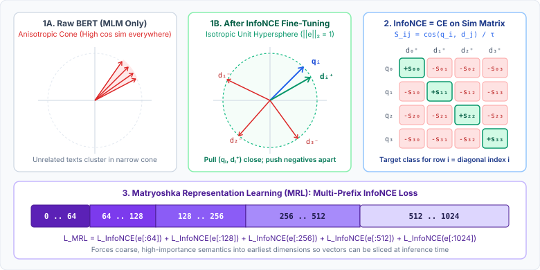
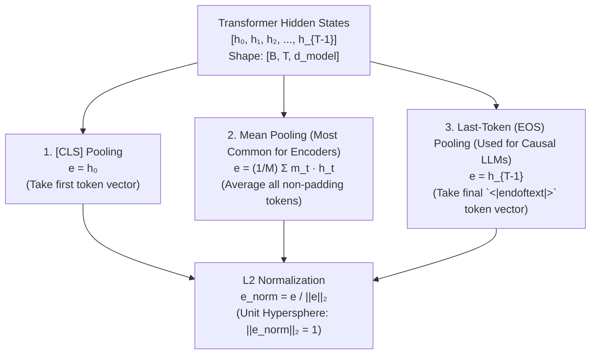

## 6. Can We Call Encoder-Only Models "Embedding Models"?

> Architectural bridge between Encoder-Only Transformers (`03`) and Contrastive Embedding Training (`04`).

In ML interviews and system design, a common question is: **"Are Encoder-Only models (like BERT) the same thing as Embedding Models?"**

The answer is **yes historically and architecturally — with two critical nuances**:
1. A **raw pre-trained encoder** (like vanilla BERT) is an *encoder backbone*, not yet a good sentence embedding model until you add a **pooling layer** and fine-tune it with a **contrastive loss**.
2. Modern top-performing embedding models are also built by adapting **Decoder-Only LLMs** (`Qwen3-Embedding`, `Mistral-Embed`, `GTE-Qwen`).

---

### 1. Why Encoder-Only Models Are Natural Embedding Backbones

Unlike causal Decoder-Only models (where token $t$ can only look backward at tokens $0 \dots t$), an Encoder-Only model (`BERT`, `RoBERTa`, `MPNet`, `ModernBERT`) uses **bidirectional self-attention**:

```
  Sentence: "The bank by the river was steep"

  Causal Decoder (GPT):
    "bank" (pos 1) only sees: ["The", "bank"]
    → It DOES NOT YET KNOW whether "bank" means a financial institution or a river bank!

  Bidirectional Encoder (BERT / ModernBERT):
    "bank" (pos 1) sees:      ["The", "bank", "by", "the", "river", "was", "steep"]
    → Every token's hidden state h_t encodes both left AND right context simultaneously.
```

Because every token representation $h_t \in \mathbb{R}^{d_{\text{model}}}$ already integrates the full sentence context, pooling those vectors produces a rich, holistic representation of the entire input sequence.

---

### 2. Raw Pre-Trained Encoder vs. Trained Sentence Embedding Model

If you take off-the-shelf `bert-base-uncased` (trained only on Masked Language Modeling + NSP) and average its token vectors to compare sentences via cosine similarity, **it performs worse than classic GloVe word embeddings!**

**Why? The Anisotropy Problem:**
- During MLM pre-training, BERT only cares about projecting individual masked token states $h_t$ through the MLM vocabulary head (`Linear(768 → 30,522)`).
- Nothing in the MLM loss forces whole-sentence vectors to be evenly distributed in $\mathbb{R}^{768}$.
- As a result, raw BERT embeddings occupy a **narrow cone** in vector space (*anisotropy*) — two completely unrelated sentences often have a cosine similarity of `0.85+` simply because they share common word frequencies.



```
  Raw BERT Vector Space (Anisotropic Cone)       Contrastively Tuned Space (Isotropic Sphere)
              y ▲                                                y ▲
                │    ↗↗↗  (all vectors squeezed                    │   ↖   ↑   ↗
                │   ↗↗↗    into a narrow cone;                     │  ←    •    →
                │  ↗↗      high cosine sim everywhere)             │   ↙   ↓   ↘
                └──────────► x                                     └──────────────► x
```

To turn a raw encoder into a true **Embedding Model** (as introduced by **SBERT / Sentence-BERT**), we must:
1. Add an explicit **Pooling + L2 Normalization layer** on top of the encoder's token outputs.
2. Fine-tune the network end-to-end on pairs/triplets using **Contrastive Loss (InfoNCE)** so cosine similarity directly reflects semantic similarity.

---

### 3. Pooling Strategies: From `[B, T, d]` Token States to `[B, d]` Embedding

An encoder outputs a tensor of shape `[batch_size, seq_len, d_model]` — one vector per token. An embedding model for search/RAG needs **one fixed-size vector $e \in \mathbb{R}^d$ per document**. Three pooling strategies are used:



| Pooling Method | Formula | Used By | Why? |
|---|---|---|---|
| **Mean Pooling** | $e = \frac{\sum_{t=1}^T m_t h_t}{\sum_{t=1}^T m_t}$ | `SBERT`, `E5`, `Nomic-Embed`, `ModernBERT-Embed` | Averages all contextualized tokens while using the attention mask $m_t \in \{0, 1\}$ to ignore `[PAD]` tokens. Usually outperforms `[CLS]` on long texts. |
| **`[CLS]` Pooling** | $e = h_0$ | `BGE`, `Snowflake-Arctic-Embed` | Avoids averaging dilution; the contrastive loss directly trains the `[CLS]` token at index `0` to aggregate the sentence. |
| **Last-Token (`EOS`) Pooling** | $e = h_{\text{last}}$ | `Qwen3-Embedding`, `E5-Mistral`, `GTE-Qwen` | Essential when the backbone is a **causal Decoder-Only LLM**, because only the final token has attended to the full sequence! |

> **Important Nuance on Decoder-Based Embedding Models:** Today, many state-of-the-art embedding models on the MTEB leaderboard (`Qwen3-Embedding`, `NV-Embed`, `GTE-Qwen2`) start from a **Decoder-Only LLM** (like Qwen or Mistral) because pretrained LLMs have vastly superior world knowledge than 2019 BERT. They convert the decoder into an embedding model in one of two ways:
> 1. **Keep the causal mask** and apply **Last-Token Pooling** on the appended `<|endoftext|>` token (since it attended to everything before it).
> 2. **Remove the causal mask entirely** during contrastive fine-tuning (turning the decoder into a bidirectional encoder!) and apply **Mean Pooling** (`LLM2Vec` / `NV-Embed` approach).

---

### 4. Bi-Encoder (Embedding Model) vs. Cross-Encoder (Reranker)

When using Encoder models for retrieval/search, there are two distinct architectures:

```
  BI-ENCODER (Embedding Model — Fast Retrieval)          CROSS-ENCODER (Reranker — High Accuracy)
  ─────────────────────────────────────────────          ────────────────────────────────────────
     Query q                 Document d                        [CLS] + Query q + [SEP] + Document d
        │                         │                                             │
   [Encoder f_θ]             [Encoder f_θ]                                [Encoder f_θ]
        │                         │                                    (Full cross-attention
     u ∈ ℝ^d                   v ∈ ℝ^d                                  between q and d!)
        └────────► cos(u, v) ◄────┘                                             │
                                                                         Linear(d → 1)
  • Encode millions of docs OFFLINE once.                                       │
  • Search = fast dot product in vector DB (FAISS/HNSW).                 Relevance Score ∈ [0, 1]
  • Used for Stage 1 Retrieval (Top-1000 → Top-50).      • Must run forward pass for EVERY (q, d) pair!
                                                         • Cannot pre-compute document vectors.
                                                         • Used for Stage 2 Reranking (Top-50 → Top-5).
```

*(For the exact loss functions — InfoNCE, Triplet, CoSENT, Matryoshka — and how to train Text Encoder/Embedding models step-by-step, see [06_Training_Encoder_and_Embedding_Models.md](file:///Users/vusheshbabuadhikari/Learning/git/Building_LLM_from_scratch/transformers_basics/04_Training_and_Alignment/06_Training_Encoder_and_Embedding_Models.md).)*

