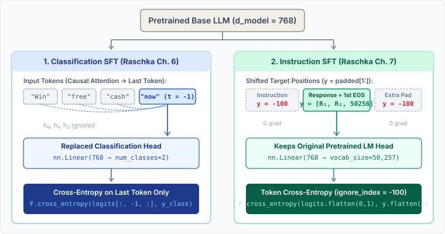
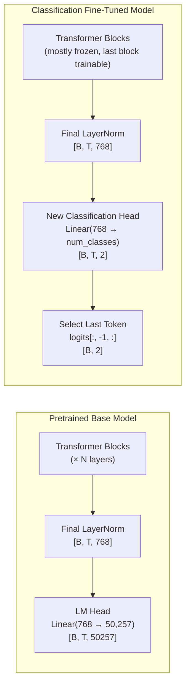

# Supervised Fine-Tuning I: Classification Fine-Tuning

> Based on *Build a Large Language Model (From Scratch)* — Chapter 6.

Pre-training produces a base model that only knows how to continue text. To adapt a pretrained LLM to downstream tasks, there are two main categories of **Supervised Fine-Tuning (SFT)**:



```
                     Pretrained Base LLM
                              │
             ┌────────────────┴────────────────┐
             ▼                                 ▼
  1. Classification Fine-Tuning     2. Instruction Fine-Tuning
     (Specialist Classifier)           (Generalist Assistant)
     • Predicts discrete class ID      • Generates arbitrary token sequences
     • Output head: d_model → C        • Keeps LM head: d_model → vocab_size
     • Loss on LAST token only         • Loss on RESPONSE tokens (masking -100)
     • e.g. Spam detection, sentiment  • e.g. Q&A, translation, summarization
```

A classification fine-tuned model is a **specialist**: it can only assign an input text to one of $C$ predefined classes (e.g., `0 = Not Spam`, `1 = Spam`), whereas an instruction fine-tuned model can answer arbitrary prompts.

---

## 1. Architectural Modification: Replacing the Output Head

A pretrained GPT model ends with a Language Modeling (LM) head that projects each token's hidden state $h_t \in \mathbb{R}^{d_{\text{model}}}$ to logits over the entire vocabulary ($V = 50,257$ in GPT-2):

$$\text{Pretrained LM Head: } \quad \text{Linear}(d_{\text{model}} \to V) \quad \text{e.g., } 768 \to 50,257$$

For classification with $C$ classes (e.g., $C = 2$ for binary spam detection), we **replace** the final `out_head` linear layer with a randomly initialized classification layer:

$$\text{Classification Head: } \quad \text{Linear}(d_{\text{model}} \to C) \quad \text{e.g., } 768 \to 2$$



---

## 2. Why Do We Use Only the **Last Token** (`logits[:, -1, :]`)?

When an input sequence of $T$ tokens passes through the Transformer, the classification head outputs a tensor of shape `[batch_size, num_tokens, num_classes]` — one `[num_classes]` vector for every token position. Yet we only pass `logits[:, -1, :]` (the **last token's** output) to the loss function. Why?

**Because of Causal Self-Attention:**

```
  Input sequence:  ["Congratulations", "you", "won", "a", "prize"]
  Position index:          0             1      2     3      4

  Who can each token attend to under the causal mask?
    Token 0 ("Congratulations"):  [0]                      ← sees 1 token
    Token 1 ("you"):              [0, 1]                   ← sees 2 tokens
    Token 2 ("won"):              [0, 1, 2]                ← sees 3 tokens
    Token 3 ("a"):                [0, 1, 2, 3]             ← sees 4 tokens
    Token 4 ("prize") [LAST]:     [0, 1, 2, 3, 4]          ← sees ALL 5 tokens!
```

- In an **Encoder-Only** model like BERT, attention is bidirectional, so the first token (`[CLS]` at index `0`) can attend to every token to its right.
- In a **Decoder-Only** model like GPT, the causal mask prevents earlier tokens from seeing later tokens. Therefore, the **last token (index `-1`) is the only token whose representation has aggregated information from the entire input sequence**.

---

## 3. Padding in Classification Batches

Text messages in a dataset have variable lengths, so to form a batch tensor `[batch_size, max_length]`, shorter sequences must be padded to match the longest sequence in the batch (or dataset).

- **Which token ID is used for padding?** For GPT-2, we reuse `<|endoftext|>` (token ID `50256`) as the padding token in `inputs`.
- **No `-100` is used in Classification Fine-Tuning:** Why? Because in classification, the target $y_b \in \{0, 1, \dots, C-1\}$ is a **single scalar class label per example** (shape `[batch_size]`), not a sequence of token IDs!
- Because the padding tokens (`50256`) sit at the right end of shorter sequences in `inputs` and causal attention flows left-to-right, the final position `logits[:, -1, :]` in a padded sequence still attends back across all real message tokens that came before the padding. *(In production frameworks like HuggingFace `GPT2ForSequenceClassification`, you can also index the last non-padding token directly via sequence lengths, though attending through `<|endoftext|>` padding to `logits[:, -1, :]` works effectively in Raschka's implementation.)*

---

## 4. Freezing vs. Unfreezing Layers

Do we need to fine-tune all 124M+ parameters of GPT-2 just to classify spam? **No.**

Early Transformer blocks capture general language syntax and token relationships that are already useful. In practice (Raschka Ch. 6), we:
1. **Freeze all parameters first:**
   ```python
   for param in model.parameters():
       param.requires_grad = False
   ```
2. **Replace `model.out_head`** with `nn.Linear(768, num_classes)` (new layers have `requires_grad = True` by default).
3. **Unfreeze the last Transformer block (`trf_blocks[-1]`) and final LayerNorm (`final_norm`):**
   ```python
   for param in model.trf_blocks[-1].parameters():
       param.requires_grad = True
   for param in model.final_norm.parameters():
       param.requires_grad = True
   ```

**Why this works so well:**
- The final Transformer block can adapt its attention weights specifically to pull classification-relevant features into the **last token's** hidden state.
- Updating only ~7M parameters instead of 124M prevents overfitting on small labeled datasets and significantly speeds up backpropagation.

---

## 5. Loss Function for Classification Fine-Tuning

Even though the task is now classification instead of text generation, the loss function is **still Cross-Entropy Loss** — the only difference is **what shapes are passed into it**:

$$\mathcal{L}_{\text{cls}} = -\frac{1}{B} \sum_{b=1}^{B} \log \frac{\exp(\text{logit}_{b, y_b})}{\sum_{c=1}^{C} \exp(\text{logit}_{b, c})}$$

```python
# Forward pass through the model
logits = model(input_batch)[:, -1, :]   # Shape: [batch_size, num_classes] e.g. [8, 2]
                                        # Only the LAST token's logits are kept!

# Target labels: 1 integer per sequence (0 = not spam, 1 = spam)
# targets.shape -> [batch_size] e.g. [8]

loss = torch.nn.functional.cross_entropy(logits, target_batch)
```

| Aspect | Pre-training (Causal LM) | Classification Fine-Tuning |
|---|---|---|
| **Output Head** | `Linear(d_model, vocab_size)` (`768 → 50257`) | `Linear(d_model, num_classes)` (`768 → 2`) |
| **Positions Supervised** | **All** token positions (`0 .. T-1`) | **Last** token position only (`-1`) |
| **Logits Passed to Loss** | `[B * T, vocab_size]` | `[B, num_classes]` |
| **Targets Passed to Loss** | `[B * T]` (shifted token IDs) | `[B]` (single class label per sequence) |
| **Uses `-100` Masking?** | No (fixed window chunks) | No (only 1 label per sequence) |
| **Loss Function** | Cross-Entropy Loss | Cross-Entropy Loss |

