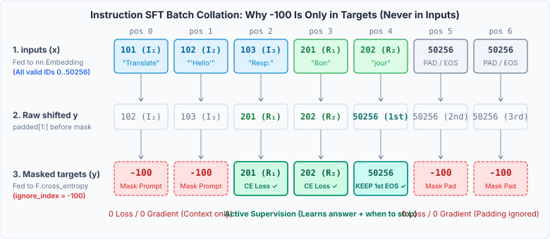

# Supervised Fine-Tuning II: Instruction Fine-Tuning & `-100` Loss Masking

> Based on *Build a Large Language Model (From Scratch)* — Chapter 7.

Pre-training teaches a model to predict the next token on raw web text. That alone produces a document auto-completer — if you ask it *"What is the capital of France?"*, it might reply with *"What is the capital of Germany? What is the capital of Italy?"* because it thinks it is reading a list of quiz questions.

**Instruction Fine-Tuning (SFT)** transforms a pretrained base model into an assistant that follows instructions across arbitrary tasks while **keeping the original vocabulary output head (`d_model → vocab_size`) intact**.

```
  Base model (pretrained)
       │
  Instruction SFT  ── teaches instruction following & when to stop (<|endoftext|>)
       │
  RLHF / DPO / GRPO  ── aligns with human preferences, improves reasoning
       │
  Deployed assistant
```

---

## 1. Formatting Instruction-Response Data (Prompt Templates)

Instruction datasets consist of `(instruction, input, output)` triples. Before tokenization, each example is formatted into a single structured text string using a **prompt template** so the model recognizes where the user's request ends and where its answer begins.

### Alpaca-Style Template (Raschka Ch. 7)
```text
Below is an instruction that describes a task. Write a response that appropriately completes the request.

### Instruction:
Convert the active sentence to passive: 'The chef cooked the meal.'

### Response:
The meal was cooked by the chef.
```

### Modern Chat Templates (e.g., LLaMA 3 / ChatML)
Production chat models use dedicated special header tokens instead of markdown `###`:
```text
<|begin_of_text|><|start_header_id|>system<|end_header_id|>
You are a helpful assistant.<|eot_id|><|start_header_id|>user<|end_header_id|>
Convert the active sentence to passive: 'The chef cooked the meal.'<|eot_id|><|start_header_id|>assistant<|end_header_id|>
The meal was cooked by the chef.<|eot_id|>
```

Regardless of template style, **the entire formatted string (instruction + response) is tokenized into one 1D sequence of token IDs**.

---

## 2. The 5-Step Batch Collation Pipeline (`custom_collate_fn`)

Unlike pre-training — where text is sliced into fixed-length chunks of say 256 or 1024 tokens with no padding — instruction examples have **variable lengths**. One instruction+response pair might be 18 tokens long; another in the same batch might be 65 tokens long.

In *Build a Large Language Model from Scratch* (Ch. 7), a custom `collate_fn` prepares each batch in **5 critical steps**:

### Step 1: Append One `<|endoftext|>` (`50256`) to Every Sequence
Before padding or shifting, we explicitly append one `<|endoftext|>` token (`50256` in GPT-2) to the end of every tokenized example:

```
  Example 1 (length 4):  [10, 20, 30, 40]        ──►  [10, 20, 30, 40, 50256]
  Example 2 (length 2):  [10, 20]                ──►  [10, 20, 50256]
```

**Why?** In instruction fine-tuning, the model must learn **when its answer is finished**. By placing `<|endoftext|>` right after the last response token, the model learns to predict `50256` as the final token of its answer. At inference time, as soon as the model generates `50256`, our generation loop stops!

### Step 2: Pad Shorter Sequences to the Batch's Maximum Length
To stack examples into a rectangular tensor `[batch_size, max_len]`, shorter sequences are padded on the right with additional `50256` (`<|endoftext|>`) tokens up to `batch_max_length`:

```
  Padded Example 1:  [10,    20,    30,    40,    50256]   (already max length = 5)
  Padded Example 2:  [10,    20,    50256, 50256, 50256]   (padded with two extra 50256s)
```

### Step 3: Shift by 1 to Create `inputs` and `targets`
Just like causal pre-training, `inputs` are all tokens except the last (`padded[:-1]`), and `targets` are all tokens shifted left by 1 (`padded[1:]`):

```
  Example 2 (before masking):
    Padded sequence:  [10,    20,    50256, 50256, 50256]
    ─────────────────────────────────────────────────────
    inputs  (x):      [10,    20,    50256, 50256]
    targets (y):      [20,    50256, 50256, 50256]
                              ▲      ▲      ▲
                              │      └──────┴── Extra padding tokens! (Must be masked)
                              └── First 50256 (Real end-of-sequence signal! KEEP THIS)
```

### Step 4: Replace Extra Padding Tokens in `targets` with `-100` (Keeping the First `50256`!)
Look closely at `targets` for Example 2 above: `[20, 50256, 50256, 50256]`.
- The **first** `50256` (at target index 1, predicted from input token `20`) is the **true end-of-response token**. We **keep** this in `targets` so the model gets a gradient teaching it to stop after token `20`.
- All **subsequent** `50256` tokens (at target indices 2 and 3) are artificial batch-padding filler. We replace them with **`-100`**:

```python
# Raschka Ch. 7 logic for masking extra padding in targets:
mask = (targets == pad_token_id)          # True wherever target == 50256
indices = torch.nonzero(mask).squeeze()   # Positions of all 50256 tokens
if indices.numel() > 1:
    targets[indices[1:]] = ignore_index   # Replace 2nd, 3rd, ... 50256 with -100!
```

```
  Example 2 (after padding mask):
    inputs  (x):      [10,    20,    50256, 50256]   ← inputs STILL have 50256 (never -100!)
    targets (y):      [20,    50256, -100,  -100 ]   ← extra padding replaced with -100
```

### Step 5: Mask Instruction Tokens in `targets` with `-100`
What about the tokens belonging to the **Instruction / Prompt** itself (e.g., `"Below is an instruction... ### Instruction: ... ### Response:"`)?
- If we leave instruction token IDs in `targets`, the model is penalized on how well it memorizes and predicts the user's prompt wording.
- In reality, at inference time the prompt is **given** by the user — the model only generates the **Response**.
- Therefore, we also set all target positions corresponding to the instruction/prompt tokens to **`-100`**, leaving only the **Response tokens + the single final `50256` (`<|endoftext|>`)** unmasked in `targets`!

---

## 3. Concrete Token-by-Token Walkthrough



Suppose our tokenized sequence is:
- **Instruction tokens (`[I₁, I₂, I₃]`):** `[101, 102, 103]` (e.g., `"### Instruction: Translate:"`)
- **Response tokens (`[R₁, R₂]`):** `[201, 202]` (e.g., `"Bonjour"`)
- **End-of-text / Pad token (`EOS`):** `50256` (`<|endoftext|>`)

Here is what a padded sequence of length 8 looks like across `inputs` and `targets`:

```
  Position index:       0       1       2       3       4       5       6
                      ┌───────┬───────┬───────┬───────┬───────┬───────┬───────┐
  inputs (x):         │  101  │  102  │  103  │  201  │  202  │ 50256 │ 50256 │
  (Role in input)     │  I₁   │  I₂   │  I₃   │  R₁   │  R₂   │  PAD  │  PAD  │
                      └───────┴───────┴───────┴───────┴───────┴───────┴───────┘
                          │       │       │       │       │       │       │
                          ▼       ▼       ▼       ▼       ▼       ▼       ▼
                      ┌───────┬───────┬───────┬───────┬───────┬───────┬───────┐
  Raw shifted target: │  102  │  103  │  201  │  202  │ 50256 │ 50256 │ 50256 │
                      └───────┴───────┴───────┴───────┴───────┴───────┴───────┘
                          │       │       │       │       │       │       │
  After masking:      ┌───────┬───────┬───────┬───────┬───────┬───────┬───────┐
  targets (y):        │ -100  │ -100  │  201  │  202  │ 50256 │ -100  │ -100  │
                      └───────┴───────┴───────┴───────┴───────┴───────┴───────┘
                        ▲   ▲   ▲───────────┬───────────▲   ▲   ▲
                        └───┴───┘           │               └───┴───┘
                       Instruction     Loss & Gradients    Extra Padding
                         Masked         Computed HERE         Masked
                        (No Loss)     (R₁, R₂, and EOS)     (No Loss)
```

Notice position `2`:
- `inputs[2]` is `103` ($I_3$, the last token of the instruction header, e.g., `### Response:\n`).
- Its target `targets[2]` is `201` ($R_1$, the **first token of the response**) — so position `2` **is NOT masked** because from the last token of the prompt, the model must predict the first token of the response!

---

## 4. Deep Dive: Why `-100`? And Why Only in `targets`?

### Q1: Why does PyTorch use `-100` to ignore tokens?
In PyTorch, `torch.nn.functional.cross_entropy(logits, targets, ignore_index=-100)` has a default parameter `ignore_index=-100`.
When computing the average cross-entropy loss across token positions:

$$\mathcal{L}_{\text{SFT}} = -\frac{1}{\sum_{t=1}^{T} \mathbb{1}[y_t \neq -100]} \sum_{t=1}^{T} \mathbb{1}[y_t \neq -100] \cdot \log P(y_t \mid x_{\le t})$$

1. Any position $t$ where `targets[t] == -100` is completely **excluded from the sum** (zero loss, zero gradient).
2. Crucially, the denominator $\sum \mathbb{1}[y_t \neq -100]$ divides **only by the number of non-ignored (active) tokens**, not by the total padded sequence length! If you didn't mask padding with `-100`, batches with lots of short padded sequences would dilute the average loss and teach the model to endlessly repeat `<|endoftext|>`.

```python
# Proof in PyTorch:
logits_1 = torch.tensor([[-1.0, 1.0], [-0.5, 1.5]])
targets_1 = torch.tensor([0, 1]) # 2 valid targets
loss_1 = F.cross_entropy(logits_1, targets_1) # 0.7240

# Add a 3rd row with target = -100:
logits_2 = torch.tensor([[-1.0, 1.0], [-0.5, 1.5], [99.0, -99.0]])
targets_2 = torch.tensor([0, 1, -100])
loss_2 = F.cross_entropy(logits_2, targets_2) # Still 0.7240! The 3rd row is 100% ignored.
```

### Q2: Why do we put `-100` ONLY in `targets` and NEVER in `inputs`?
1. **Embedding Lookup Would Crash:** The very first layer of the Transformer is `self.tok_emb = nn.Embedding(vocab_size, d_model)`, which indexes into a matrix of rows `0` to `50,256`. Passing `-100` inside `inputs` will immediately throw an `IndexError: index out of range in self` because `-100` is not a valid vocabulary token ID!
2. **Instruction Tokens Must Participate in Self-Attention:** Even when we mask instruction tokens with `-100` in `targets`, the model still needs to **read** the instruction in `inputs`! By keeping the real token IDs in `inputs`, the instruction tokens flow through every Transformer layer and populate the **Key ($K$) and Value ($V$) matrices**. When response tokens compute causal self-attention, they attend back to the instruction's $K$ and $V$ vectors to know what question they are answering.
3. **Why extra `50256` padding in `inputs` doesn't hurt earlier tokens:** Because of the **causal attention mask**, real response tokens at positions $0 \dots k$ can never look forward at the extra `50256` padding tokens sitting at positions $> k$. And at positions $> k$ where `inputs` has `50256`, `targets` has `-100`, so whatever output the model computes at those padded input positions is thrown away by the loss function!

---

## 5. Summary Comparison: Pre-training vs. Classification SFT vs. Instruction SFT

| Feature | Pre-training (Ch. 5) | Classification SFT (Ch. 6) | Instruction SFT (Ch. 7) |
|---|---|---|---|
| **Goal** | Next-token continuation on raw text | Classify text into $C$ discrete categories | Follow instructions & generate responses |
| **Output Head** | `Linear(d_model, vocab_size)` | **Replaced:** `Linear(d_model, num_classes)` | **Kept:** `Linear(d_model, vocab_size)` |
| **Input (`x`) Shape** | `[B, T]` (fixed-size chunks) | `[B, T]` (padded with `50256`) | `[B, T]` (`padded[:-1]`, uses `50256` for pad) |
| **Target (`y`) Shape** | `[B, T]` (shifted by 1) | `[B]` (1 class ID per example) | `[B, T]` (`padded[1:]`, shifted by 1) |
| **Which Positions Get Loss?** | **Every** token position | **Only the last token** (`logits[:, -1, :]`) | **Only response tokens + 1st `<\|endoftext\|>`** |
| **Where is `-100` Used?** | Not used (no padding) | Not used (1 scalar label per sequence) | In `targets` only: on extra padding & instruction tokens |
| **Why Keep 1st `50256` in Target?** | Naturally appears between documents | N/A (model outputs a class, not text) | So the model learns **when to stop generating** |
| **Core Loss Function** | Cross-Entropy Loss (`F.cross_entropy`) | Cross-Entropy Loss (`F.cross_entropy`) | Cross-Entropy Loss (`F.cross_entropy`, `ignore_index=-100`) |

