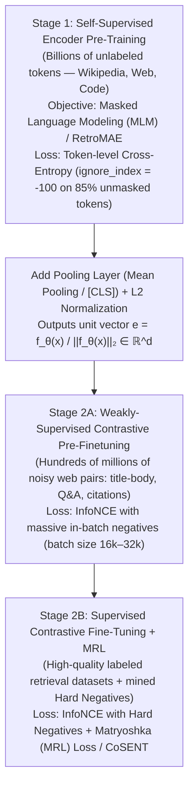
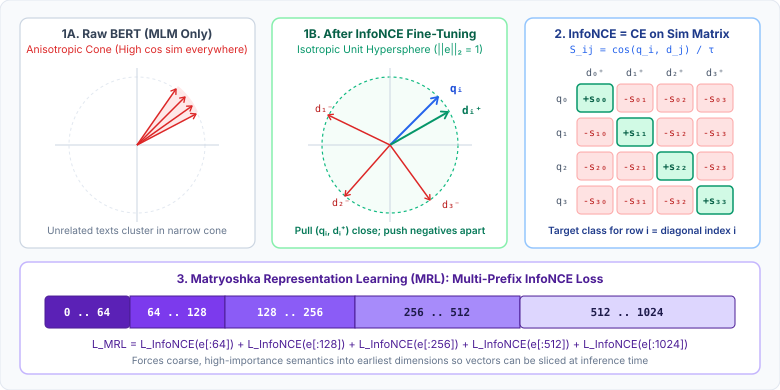

# Training Text Encoder-Only & Embedding Models: Objectives and Loss Functions

> How Encoder-Only models (BERT, RoBERTa, ModernBERT) and Text Embedding models (`Qwen3-Embedding`, `BGE-M3`, `E5`, `OpenAI text-embedding-3`) are trained from scratch to deployment.

A fundamental distinction that comes up constantly in ML interviews is:
- **Generative Models (Decoders)** optimize **token-level probability distributions** over a fixed discrete vocabulary ($V \approx 50\text{k–}150\text{k}$).
- **Embedding Models (Bi-Encoders)** optimize **geometric distance in a continuous vector space** ($\mathbb{R}^d$), mapping input text $x$ to an L2-normalized vector $e = f_\theta(x) \in \mathbb{R}^d$ on a unit hypersphere ($\|e\|_2 = 1$).

```
  GENERATIVE LLM (Decoder SFT)                      EMBEDDING MODEL (Bi-Encoder)
  ────────────────────────────                      ────────────────────────────
  Input:  [Prompt + Response tokens]                Input:  Query q, Positive Doc d⁺, Negatives {d⁻}
  Output: Logits over Vocab [B, T, V]               Output: Pooled unit vectors u, v ∈ ℝ^d
  Loss:   Token-level Cross-Entropy                 Loss:   Sequence-level InfoNCE (Contrastive CE)
          (with -100 on prompt & pad)                       over scaled cosine similarities sim(u, v)/τ
```

---

## 1. The Full Two-Stage Training Pipeline for Text Encoder / Embedding Models

If someone asks in an interview: **"How do you train an Encoder-Only / Text Embedding model from scratch?"**, the pipeline has two distinct stages (often split into Stage 1 Pre-training + Stage 2A Weakly-Supervised Contrastive + Stage 2B Supervised Hard-Negative Contrastive):



---

## 2. Stage 1: Encoder Pre-Training (Token-Level Cross-Entropy)

Before becoming an embedding model (or a task classifier), an encoder backbone is first pre-trained on massive unlabeled text so its bidirectional self-attention layers learn syntax, semantics, and world knowledge.

### A. Masked Language Modeling (MLM) — And How `-100` Is Used Here Too!
In BERT, RoBERTa, and ModernBERT, 15% of input tokens are selected for corruption (80% replaced with `[MASK]`, 10% random token, 10% unchanged).
- **How is the loss computed?** Just like Instruction SFT uses `-100` to ignore prompt and padding tokens, **MLM sets `labels = -100` for all 85% unmasked tokens!**
- Only the 15% selected positions have their true original token IDs in `labels`, and standard **Cross-Entropy Loss** (`F.cross_entropy(logits.view(-1, V), labels.view(-1), ignore_index=-100)`) is computed over the vocabulary $V$:

```
  Original sentence:  ["The",  "chef",   "cooked", "the",  "meal" ]
  Corrupted input x:  ["The",  "[MASK]", "cooked", "the",  "apple"]  ("chef"→[MASK], "meal"→random)
  MLM Target y:       [ -100,   "chef",   -100,     -100,  "meal" ]
                                  ▲                          ▲
                           CE Loss computed ONLY on the 15% selected positions!
```

### B. Modern Pre-Training Improvements Beyond Original BERT
- **RoBERTa / DeBERTa / ModernBERT:**
  - **Drops Next Sentence Prediction (NSP):** NSP was too easy (it only tested topic similarity rather than discourse coherence); removing it and training solely on dynamic MLM (up to 30% masking rate in ModernBERT) yields stronger representations.
  - **ModernBERT (2024):** Replaces absolute positional embeddings with **RoPE (Rotary Positional Embeddings)**, uses GeGLU activations, alternating local/global FlashAttention up to **8,192 tokens**, and removes bias terms.
- **RetroMAE (Retrieval-Oriented Masked Auto-Encoding):**
  - Designed specifically to pre-train encoders for embeddings: the encoder masks 15–30% of tokens and compresses the sentence into a single `[CLS]` vector; a tiny 1-layer shallow decoder must reconstruct a heavily masked (50–70% masked) version of the sentence *using only that single `[CLS]` vector*. This forces the encoder's pooled vector to pack the entire sentence's meaning even before contrastive training!
- **Unsupervised SimCSE (Dropout as Data Augmentation):**
  - Passes the **exact same sentence $x$ twice** through the encoder with two different random **dropout masks** ($z_1, z_2$). Those two slightly different output vectors $(e_i, e_i^+)$ form a positive pair, while all other sentences in the batch act as negatives. This cures BERT's anisotropy without needing any labeled pairs!

---

## 3. Stage 2: Embedding Fine-Tuning (Contrastive & Metric Losses)

Once the encoder is pre-trained and equipped with a pooling + L2-normalization layer ($e = f_\theta(x) \in \mathbb{R}^d$, $\|e\|_2 = 1$), we train it to shape the **geometry of the vector space**: pulling semantically similar pairs $(q_i, d_i^+)$ close together on the unit hypersphere while pushing unrelated or contradictory pairs $(q_i, d_j^-)$ apart.



### A. InfoNCE / Multiple Negatives Ranking Loss (The Industry Standard)

Used by virtually every modern retrieval and RAG embedding model (`E5`, `BGE`, `GTE`, `Nomic`, `OpenAI`, `Qwen3-Embedding`).

Given a batch of $N$ positive pairs $(q_i, d_i^+)$ — such as `(query, relevant_passage)`:
1. Every other positive passage $d_j^+$ ($j \neq i$) in the same batch automatically serves as an **in-batch negative** (giving you $N - 1$ free negatives per query!).
2. Each query is also paired with $M$ **mined hard negatives** $\{d_{i,1}^-, \dots, d_{i,M}^-\}$ — passages that look lexically similar (e.g., high BM25 keyword overlap) but **do not** answer the query.

$$\mathcal{L}_{\text{InfoNCE}} = -\frac{1}{N} \sum_{i=1}^{N} \log \frac{\exp\!\big(\text{sim}(q_i, d_i^+) / \tau\big)}{\exp\!\big(\text{sim}(q_i, d_i^+) / \tau\big) + \underbrace{\sum_{j \neq i} \exp\!\big(\text{sim}(q_i, d_j^+) / \tau\big)}_{\text{In-Batch Negatives}} + \underbrace{\sum_{m=1}^{M} \exp\!\big(\text{sim}(q_i, d_{i,m}^-) / \tau\big)}_{\text{Mined Hard Negatives}}}$$

where $\text{sim}(u, v) = \frac{u \cdot v}{\|u\|_2 \|v\|_2}$ is **cosine similarity** (just the dot product $u \cdot v$ when L2-normalized) and $\tau$ is a **temperature hyperparameter** (typically $\tau \in [0.01, 0.05]$) that sharpens the similarity differences.

#### The Big Connection: InfoNCE IS Cross-Entropy Loss!
Look closely at the InfoNCE formula above:
- In **Generative LLMs**, we compute a vector of **vocabulary logits** $z \in \mathbb{R}^V$ and pass `(logits, target_token_id)` into `F.cross_entropy`.
- In **InfoNCE**, for query $i$, we compute a vector of **scaled similarity scores** $s_i = [\text{sim}(q_i, d_1)/\tau, \dots, \text{sim}(q_i, d_N)/\tau] \in \mathbb{R}^N$, and the ground-truth "class index" is simply the diagonal index $y_i = i$ (the matching document $d_i^+$)!

```python
# Complete PyTorch implementation of InfoNCE (In-Batch Negatives):
# q_emb: [batch_size, d_model] (L2-normalized query embeddings)
# d_emb: [batch_size, d_model] (L2-normalized positive document embeddings)

# 1. Compute N × N cosine similarity matrix scaled by temperature τ:
sim_matrix = (q_emb @ d_emb.T) / temperature   # Shape: [N, N]

# 2. The correct match for query i is document i (the main diagonal 0, 1, ..., N-1):
labels = torch.arange(sim_matrix.size(0), device=sim_matrix.device)

# 3. InfoNCE is literally standard Cross-Entropy Loss over the similarity matrix!
loss = torch.nn.functional.cross_entropy(sim_matrix, labels)
```

```
  N × N Scaled Similarity Matrix S = (Q · Dᵀ) / τ:

              d₀⁺     d₁⁺     d₂⁺     d₃⁺
       q₀  [ s₀₀ ✓   s₀₁ ✗   s₀₂ ✗   s₀₃ ✗ ]   ← Target class = 0
       q₁  [ s₁₀ ✗   s₁₁ ✓   s₁₂ ✗   s₁₃ ✗ ]   ← Target class = 1
       q₂  [ s₂₀ ✗   s₂₁ ✗   s₂₂ ✓   s₂₃ ✗ ]   ← Target class = 2
       q₃  [ s₃₀ ✗   s₃₁ ✗   s₃₂ ✗   s₃₃ ✓ ]   ← Target class = 3
```

---

### B. Triplet Loss (Margin-Based Ranking)

Historically used in early Siamese networks and FaceNet/SBERT. Given an explicit triplet `(anchor a, positive p, negative n)` and distance metric $d(u, v) = 1 - \cos(u, v)$:

$$\mathcal{L}_{\text{Triplet}} = \max\!\big(0,\; d(a, p) - d(a, n) + m\big)$$

- Enforces that the distance between anchor and positive $d(a, p)$ is smaller than the distance between anchor and negative $d(a, n)$ by at least a margin $m$ (e.g., $m = 0.2$).
- **Why InfoNCE replaced Triplet Loss at scale:** Triplet Loss only pushes against **1 negative** per forward pass and gives zero gradient once $d(a, n) - d(a, p) > m$. InfoNCE simultaneously contrasts against **thousands of in-batch + hard negatives** in a single matrix multiplication!

---

### C. Cosine Similarity MSE / CoSENT / AnglE Loss (For Graded Similarity)

What if your training data does **not** have binary `(positive, negative)` pairs, but instead has **continuous human similarity ratings** (e.g., Semantic Textual Similarity / STS benchmarks scored from `0.0` to `5.0`, normalized to $y_{ij} \in [0, 1]$)?

1. **Cosine MSE Loss:** Directly minimizes Mean Squared Error between cosine similarity and the normalized score:
   $$\mathcal{L}_{\text{MSE}} = \frac{1}{N} \sum_{i} \big(\cos(u_i, v_i) - y_i\big)^2$$
2. **CoSENT / AnglE Loss:** Because cosine similarity saturates near $\pm 1$ (where gradients of $\cos(\theta)$ flatten to zero), **CoSENT** optimizes the *rank order* of pairs where ground-truth similarity $\text{sim}_{\text{true}}(i, j) > \text{sim}_{\text{true}}(k, l)$:
   $$\mathcal{L}_{\text{CoSENT}} = \log \left(1 + \sum_{\text{sim}_{\text{true}}(i,j) > \text{sim}_{\text{true}}(k,l)} \exp\!\left(\frac{\cos(u_k, v_l) - \cos(u_i, v_j)}{\tau}\right)\right)$$
   **AnglE Loss** additionally computes angle differences in the complex plane to eliminate cosine saturation entirely.

---

### D. Matryoshka Representation Learning (MRL) Loss (Modern Standard)

A major bottleneck of vector databases is RAM cost: storing 100 million 1024-dimensional `FP32` vectors requires ~400 GB of memory. Normally, if you slice a 1024-d embedding down to its first 128 dimensions, retrieval quality collapses because semantic information is spread evenly across all 1024 coordinates.

**Matryoshka Loss** (used in `OpenAI text-embedding-3`, `Nomic-Embed-v1.5`, and `Qwen3-Embedding`) wraps InfoNCE across **multiple nested dimension prefixes** $\mathcal{M} = \{64, 128, 256, 512, 1024\}$ during training:

$$\mathcal{L}_{\text{MRL}} = \sum_{m \in \{64, 128, 256, 512, 1024\}} w_m \cdot \mathcal{L}_{\text{InfoNCE}}\!\big(e_{[:, :m]}\big)$$

```
  Full 1024-d Embedding Vector Trained with Matryoshka Loss (MRL):
  ┌────────┬────────┬────────────┬────────────────────┬────────────────────────────────────┐
  │ 0..64  │ 64..128│  128..256  │      256..512      │              512..1024             │
  └────────┴────────┴────────────┴────────────────────┴────────────────────────────────────┘
  ├──64-d──┤ (Coarse semantics: standalone InfoNCE loss #1)
  ├──────128-d──────┤ (Medium semantics: standalone InfoNCE loss #2)
  ├────────────256-d─────────────┤ (Fine semantics: standalone InfoNCE loss #3)
  ├──────────────────────512-d────────────────────────┤ (Standalone InfoNCE loss #4)
  ├─────────────────────────────────────────1024-d─────────────────────────────────────────┤ (Loss #5)
```

Because every prefix slice $e_{[:m]}$ is independently L2-normalized and trained with InfoNCE, the model is forced to pack the **most critical semantic features into the earliest dimensions** (like Russian nesting dolls). At deployment, you can truncate vectors to 256-d ($4\times$ less memory) and retain ~98% of full 1024-d retrieval accuracy!

---

## 4. Alternative Stage 2: Supervised Task Fine-Tuning on an Encoder

Besides training an encoder to produce embeddings (Bi-Encoder), you can also fine-tune a pre-trained Encoder-Only model directly on supervised NLP tasks using **Cross-Entropy Loss**:

| Task | Output Head Attached to Encoder | Which Tokens Get Loss? | Loss Function |
|---|---|---|---|
| **Sequence Classification** (Sentiment, NLI, Topic) | `Linear(d_model → C)` on `[CLS]` token (`h₀`) | Only position `0` (`[CLS]`) | Cross-Entropy over $C$ classes |
| **Token Classification** (Named Entity Recognition, POS) | `Linear(d_model → C)` on **every** token (`h₁..h_T`) | Every real word token (`-100` on `[CLS]`, `[SEP]`, `[PAD]`, and `##subwords`) | Token-level Cross-Entropy over $C$ entity tags |
| **Extractive QA** (SQuAD) | `Linear(d_model → 2)` (predicts `start_logit` and `end_logit` per token) | Start index $i_{\text{start}}$ and End index $i_{\text{end}}$ over passage length $T$ | $\frac{1}{2}\big(\text{CE}(\text{start}) + \text{CE}(\text{end})\big)$ |
| **Cross-Encoder Reranker** | `Linear(d_model → 1)` on `[CLS]` of `[CLS] q [SEP] d [SEP]` | Only position `0` (`[CLS]`) | Binary Cross-Entropy (BCE) / Margin MSE |

---

## 5. Top Modern Text Embedding Models (MTEB Landscape)

| Category | Model | Backbone Type | Key Strengths |
|---|---|---|---|
| **Open-Weights (Top Overall)** | **Qwen3-Embedding** (0.6B / 4B / 8B) | Adapted Decoder LLM (EOS pooling) | Top MTEB v2 English, code & multilingual retrieval; supports instruction prefixes & Matryoshka slicing. |
| **Open-Weights (Hybrid & Multilingual)** | **BGE-M3** (BAAI) | Encoder-Only (`XLM-RoBERTa` 560M) | Simultaneously outputs **Dense**, **Sparse (lexical weights)**, and **Multi-Vector (ColBERT)** representations up to 8,192 tokens. |
| **Open-Weights (Fast Encoder)** | **ModernBERT-Embed** / **Nomic Embed v1.5** | Encoder-Only (RoPE + FlashAttention) | True bidirectional encoders with 8,192 context, Matryoshka dimensions, and ultra-low CPU/GPU latency. |
| **Commercial APIs** | **Voyage 4** / **Cohere Embed 4** / **OpenAI `text-embedding-3-large`** | Proprietary (MRL-enabled) | Strong zero-shot domain retrieval, native multimodal image+text embeddings (Cohere 4 / Gemini Embedding), configurable MRL dimensions. |

---

## 6. Quick Interview Tie-Together: Decoder SFT vs. Encoder Embedding Training

| Dimension | Generative SFT (Decoder-Only) | Embedding Training (Bi-Encoder) |
|---|---|---|
| **Primary Goal** | Autoregressively generate the next token | Map whole sequences to points in $\mathbb{R}^d$ where distance = meaning |
| **Attention Mask** | Causal (Lower-triangular look-ahead mask) | Bidirectional (Full unmasked attention, or EOS-pooled causal) |
| **Output Layer** | LM Head `Linear(d_model → vocab_size)` | Pooling Layer (`Mean` / `[CLS]` / `EOS`) + L2 Normalization |
| **What Enters the Loss?** | Vocabulary logits `[B * T, V]` vs. shifted token IDs | Cosine similarity matrix `[N, N]` scaled by temperature $1/\tau$ |
| **Core Loss Function** | Token-level Cross-Entropy (`ignore_index=-100` on prompt & pad) | Sequence-level **InfoNCE** (Cross-Entropy over in-batch + hard negatives) + **Matryoshka (MRL)** |

*(Next: To see how these exact same concepts extend to **Visual Encoder-Only Models (ViT, CLIP, SigLIP, MAE, DINOv2)**, see [03_ViT_Pretraining_Objectives.md](file:///Users/vusheshbabuadhikari/Learning/git/Building_LLM_from_scratch/transformers_basics/07_Multimodality_VLMs_and_VLAs/03_ViT_Pretraining_Objectives.md) in Folder `07`.)*

