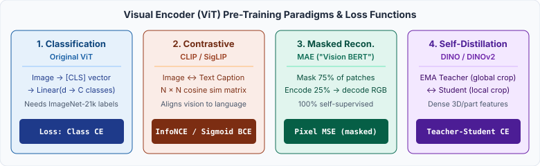

## 1. ViT Pretraining Objectives & Visual Encoder Loss Functions

> How Visual Encoder-Only Models (`ViT`, `CLIP`, `SigLIP`, `MAE`, `DINOv2`) are trained — and how their loss functions mirror Text Encoder-Only models ([06_Training_Encoder_and_Embedding_Models.md](file:///Users/vusheshbabuadhikari/Learning/git/Building_LLM_from_scratch/transformers_basics/04_Training_and_Alignment/06_Training_Encoder_and_Embedding_Models.md)).

A **Vision Transformer (ViT)** is architecturally an **Encoder-Only Transformer** (bidirectional self-attention, no causal mask, prepended `[CLS]` token) where `16×16` image patches replace text tokens.

Before a ViT is bolted into a VLM — or used as a standalone **Visual Embedding Model** for image search, zero-shot classification, or segmentation — it must be trained so its patch and `[CLS]` vectors are meaningful. Four major training paradigms exist, each using a distinct loss function and supervision signal:



---

### 1.1 Supervised Classification (Original ViT)

```
  Supervision:  ImageNet labels  (1,000 or 21,843 classes, human annotated)

  Mechanism:
  Image → Patchify → ViT Encoder → h_CLS ([CLS] token vector, index 0)
                                          │
                                   Linear(d_vit → C)
                                          │
                                   Logits over C classes
                                          ↓
                             Cross-Entropy vs. true class label y
```

$$\mathcal{L}_{\text{Sup-ViT}} = -\log \frac{\exp(W_{y} \cdot h_{\text{CLS}})}{\sum_{c=1}^{C} \exp(W_{c} \cdot h_{\text{CLS}})}$$

- **Direct parallel to Text Encoders:** Identical to BERT Sequence Classification (except trained from scratch on 14M–300M labeled images like ImageNet-21k or JFT-300M because ViTs lack the inductive biases of CNNs like translation equivariance).
- **Limitation:** Human class labels are expensive and force the model to only care about a fixed list of $C$ nouns rather than rich visual descriptions.

---

### 1.2 Multimodal Contrastive Learning (CLIP & SigLIP — Visual Embedding Standard)

Instead of fixed class IDs, **CLIP** and **SigLIP** train a **Dual-Encoder (Bi-Encoder)** consisting of a **ViT Image Encoder** $f_\theta$ and a **Text Encoder** $g_\phi$ jointly on hundreds of millions of web-scraped `(image, alt-text caption)` pairs:

```
  Supervision:  (image_i, caption_i) pairs — scraped from the web, no manual labels

  Mechanism:
  Image_i   → ViT Image Encoder → Pool + L2-norm → Image embedding I_i ∈ ℝ^d  (||I_i||₂ = 1)
  Caption_i → Text Encoder      → Pool + L2-norm → Text embedding  T_i ∈ ℝ^d  (||T_i||₂ = 1)

  Build N×N cosine similarity matrix S_ij = (I_i · T_j) / τ for a batch of N pairs:
  ┌──────────────────────────────────────────┐
  │        cap₁   cap₂   cap₃  ...  capN    │
  │ img₁  [ ✓     ✗      ✗    ...   ✗  ]   │  ← Row i:    match img_i to its true cap_i
  │ img₂  [ ✗     ✓      ✗    ...   ✗  ]   │  ← Column j: match cap_j to its true img_j
  │ img₃  [ ✗     ✗      ✓    ...   ✗  ]   │
  │  ...                                    │
  │ imgN  [ ✗     ✗      ✗    ...   ✓  ]   │  ← Diagonal = N positive pairs
  └──────────────────────────────────────────┘    Off-diagonal = N² - N in-batch negatives!
```

#### A. CLIP Loss: Symmetric InfoNCE (Row-wise + Column-wise Cross-Entropy)
Just like text embedding models use InfoNCE, **CLIP** computes **Symmetric InfoNCE Loss** — averaging Cross-Entropy across rows (image-to-text retrieval) and columns (text-to-image retrieval):

$$\mathcal{L}_{I \to T} = -\frac{1}{N} \sum_{i=1}^{N} \log \frac{\exp(I_i \cdot T_i / \tau)}{\sum_{j=1}^{N} \exp(I_i \cdot T_j / \tau)}, \qquad \mathcal{L}_{T \to I} = -\frac{1}{N} \sum_{i=1}^{N} \log \frac{\exp(I_i \cdot T_i / \tau)}{\sum_{j=1}^{N} \exp(I_j \cdot T_i / \tau)}$$

$$\mathcal{L}_{\text{CLIP}} = \frac{1}{2} \big(\mathcal{L}_{I \to T} + \mathcal{L}_{T \to I}\big)$$

where $\tau$ is a **learnable temperature parameter** (initialized to $0.07$ and clipped to prevent training instability).

#### B. SigLIP Loss: Pairwise Sigmoid Binary Cross-Entropy (Used in PaliGemma, Qwen-VL, LLaVA-OneVision)
In CLIP's InfoNCE, the denominator $\sum_{j=1}^N \exp(I_i \cdot T_j / \tau)$ requires a global `all_gather` across all GPUs to compute the softmax over a massive batch ($N = 32,768$).
**SigLIP** replaces the batch-wide softmax with an **independent binary logistic (sigmoid) loss on every $(i, j)$ pair**:

$$\mathcal{L}_{\text{SigLIP}} = -\frac{1}{N^2} \sum_{i=1}^{N} \sum_{j=1}^{N} \log \frac{1}{1 + \exp\!\big(-z_{ij} (t \cdot I_i \cdot T_j + b)\big)}$$

where $z_{ij} = +1$ for matching diagonal pairs ($i = j$) and $z_{ij} = -1$ for non-matching off-diagonal pairs ($i \neq j$), $t$ is a learned temperature scale, and $b$ is a learned negative bias (initialized to $-10$ so the huge number of negative pairs starts with low loss).

| Feature | CLIP (Symmetric InfoNCE) | SigLIP (Pairwise Sigmoid BCE) |
|---|---|---|
| **Loss Function** | Softmax Cross-Entropy over rows & columns | Independent Sigmoid Binary Cross-Entropy per pair |
| **Batch Dependency** | Coupled across entire batch (needs global sum) | Decoupled per $(i, j)$ pair |
| **Small-Batch Stability** | Degrades below batch size 4k | Works well at both small (512) and huge (32k) batch sizes |
| **VLM Adoption** | LLaVA-1.5, OpenAI CLIP | **Modern VLM standard** (SigLIP-SO400M in LLaVA-Next, PaliGemma) |

---

### 1.3 Masked Autoencoder (MAE — "BERT for Vision, But Asymmetric")

How do you train a ViT on unlabeled images **without any text captions or class labels**? By masking patches and reconstructing them — the visual equivalent of BERT's Masked Language Modeling (MLM), with two crucial differences:

```
  Supervision:  The raw image itself — 100% self-supervised, no labels or captions

  Mechanism:
  1. Randomly mask 75% of image patches (vs. only 15% in BERT!)
  2. ViT Encoder ONLY processes the 25% visible patches (4× faster encoder pass!)
  3. Append shared learnable [MASK] vectors at the 75% missing positions
  4. Lightweight narrow Decoder reconstructs the raw RGB pixel values of masked patches

  ┌────┬────┬────┬────┐       ┌────┬────┬────┬────┐
  │ p₁ │ ██ │ p₃ │ ██ │  →   │ p₁ │ p̂₂ │ p₃ │ p̂₄ │
  ├────┼────┼────┼────┤  ViT  ├────┼────┼────┼────┤
  │ ██ │ p₆ │ ██ │ p₈ │  +   │ p̂₅ │ p₆ │ p̂₇ │ p₈ │
  └────┴────┴────┴────┘ dec.  └────┴────┴────┴────┘
   Input (25% visible)          Reconstructed pixels
```

#### Why 75% Masking in Vision vs. 15% in Text (BERT)? And Why MSE Instead of Cross-Entropy?
1. **Information Density (75% vs. 15%):** Language is highly information-dense — if you mask 15% of words, predicting the missing word requires deep semantic understanding. Images have massive **spatial redundancy** — if you only mask 15% of patches, the model can trivially interpolate a missing patch from its immediate neighbors' colors without learning what object is in the image! Masking **75%** destroys local interpolation shortcuts and forces the encoder to learn global object gestalt.
2. **Continuous Pixels vs. Discrete Vocabulary (MSE vs. CE):** Text tokens come from a finite discrete vocabulary ($V = 30\text{k}$), so BERT outputs logits and uses Cross-Entropy. Image patches are continuous RGB values ($16 \times 16 \times 3 = 768$ floats), so **MAE** outputs 768 continuous numbers per patch and minimizes **Mean Squared Error (MSE)** only on the masked patch set $\mathcal{M}$:

$$\mathcal{L}_{\text{MAE}} = \frac{1}{|\mathcal{M}|} \sum_{i \in \mathcal{M}} \big\|\hat{p}_i - p_i^{\text{norm}}\big\|_2^2$$

*(Note: A related family called **BEiT** first tokenizes image patches into discrete visual codebook IDs using a VQ-VAE and then uses standard token **Cross-Entropy Loss** just like BERT!)*

---

### 1.4 Self-Distillation Without Labels (DINO & DINOv2 — Pure Visual Embedding Standard)

While CLIP learns embeddings aligned to *text*, captions often ignore fine-grained visual geometry (e.g., a caption says *"A dog on a couch"* and ignores lighting, depth, 3D pose, and background objects).

**DINO / DINOv2** (by Meta) trains the strongest **pure-vision embedding backbone** using **Self-Distillation with No Labels**:

```
                     Same Image x
                    ┌──────┴──────┐
     Global Crop x_g (224px)   Local Crop x_l (96px, sees <50% of image)
            │                             │
    ┌───────▼────────┐           ┌────────▼───────┐
    │ Teacher ViT    │           │ Student ViT    │
    │ (EMA weights)  │           │ (Trained via   │
    │ Stop-Gradient! │           │  backprop)     │
    └───────┬────────┘           └────────┬───────┘
            │                             │
    Softmax(z_t / τ_t)           Softmax(z_s / τ_s)
     (Centered & sharp)                   │
            └────────► Cross-Entropy ◄────┘
                 L_DINO = - Σ P_t · log P_s
```

- **How it works:** A **Student ViT** (given small local crops and masked patches) is trained to match the output probability distribution of a **Teacher ViT** (given full global crops, whose weights are an Exponential Moving Average $\theta_t \leftarrow \lambda \theta_t + (1-\lambda)\theta_s$ of the student).
- **Loss Function:** Combines **Cross-Entropy Loss** between Teacher and Student `[CLS]` outputs ($\mathcal{L}_{\text{DINO}}$) + patch-level masked Cross-Entropy ($\mathcal{L}_{\text{iBOT}}$):
  $$\mathcal{L}_{\text{DINO}} = -\sum_{k=1}^{K} P_{\text{teacher}}(k \mid x_{\text{global}}) \log P_{\text{student}}(k \mid x_{\text{local}})$$
- **Why DINOv2 matters:** Because the student must predict the global representation from only a tiny local crop, DINOv2's attention maps and patch embeddings spontaneously learn object boundaries, 3D depth, and part-whole correspondence without a single human label!

---

### 1.5 Summary Comparison: Text Encoders vs. Visual Encoders

| Model / Method | Modality | Supervision Signal | Masking Ratio | Output Used | Core Loss Function | Best Downstream Use Case |
|---|---|---|---|---|---|---|
| **BERT / ModernBERT** | Text | Self-supervised text | **15%–30%** tokens | `[CLS]` or token states | **Cross-Entropy** (`ignore_index=-100` on unmasked) | Classification, NER, Encoder backbone |
| **Text Bi-Encoder (`BGE`, `E5`, `Qwen3-Emb`)** | Text | `(query, passage⁺, passage⁻)` | None | Pooled + L2-norm vector | **InfoNCE (Contrastive CE)** + **Matryoshka (MRL)** | Text RAG, Semantic Search, Clustering |
| **Supervised ViT** | Vision | Human class labels (`ImageNet`) | None | `[CLS]` token | **Cross-Entropy** over $C$ classes | Closed-set image classification |
| **CLIP / SigLIP** | Vision + Text | Web `(image, caption)` pairs | None | Pooled Image & Text vectors | **Symmetric InfoNCE** (CLIP) or **Sigmoid BCE** (SigLIP) | **VLM Vision Backbone**, Zero-shot classification, Multimodal search |
| **MAE (Masked Autoencoder)** | Vision | Raw pixels (self-supervised) | **75%** of patches | All patch tokens (Decoder dropped) | **Pixel MSE** on masked patches only | Fine-tuning for detection & segmentation |
| **DINOv2** | Vision | Multi-crop self-distillation | ~50% (in iBOT branch) | `[CLS]` + dense patch tokens | **Teacher-Student Cross-Entropy** + Sinkhorn/Centering | Dense vision tasks (depth, segmentation, visual similarity) |

---
